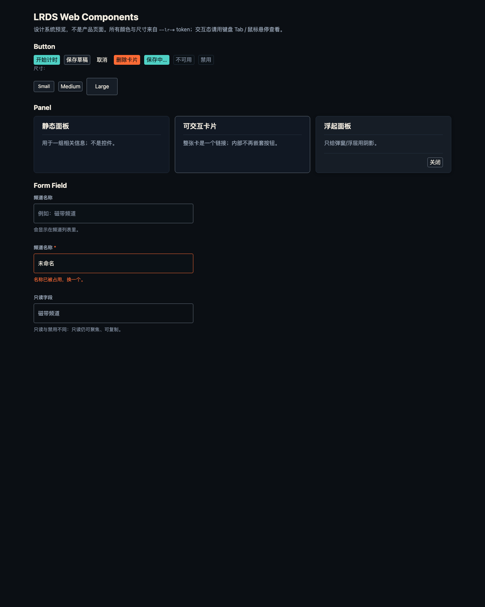

# Web Kit · 网页介质适配

> 消费 `design/tokens/dist/web/*.css`（由 `design/tools/build_tokens.ts` 生成）。
> 当前试点：[《未来档案》网站](../../../projects/website/README.md)、[LiveFab 门户](../../../projects/livefab/portal/src/layouts/Base.astro)。

## 一、产物

| 文件 | 内容 | 谁消费 |
| --- | --- | --- |
| `tokens/dist/web/future-archive.css` | `sys.*` + `product.future-archive.*` + 旧变量别名 | 网站 |
| `tokens/dist/web/livefab.css` | `sys.*` + `product.livefab.*` + 旧变量别名 | LiveFab 门户 |
| `projects/website/app/assets/tokens.generated.css` | `future-archive.css` 的**产品副本**（生成物，勿手改） | 网站 Nuxt 构建 |
| `projects/livefab/portal/src/assets/tokens.generated.css` | `livefab.css` 的**产品副本**（生成物，勿手改） | LiveFab Astro 构建 |

> 每个 Web 产品一份 CSS：`sys.*` 共享，`product.*` 与旧变量别名各自独立——避免两个产品的 `--bg` 互相覆盖。

## 二、接入方式

### 网站（Nuxt）

1. 把 `tokens.generated.css` 放在 `app/assets/`；
2. 在 `nuxt.config.ts` 的 `css` 数组里**排在主题之前**：
   ```ts
   css: ['~/assets/tokens.generated.css', '~/assets/theme.css'],
   ```
3. 主题里删除裸色值，改用：
   ```css
   :root {
     --focus-width: var(--lr-border-focus);
     --maxw: var(--lr-grid-web-max-width);
   }
   ```

### LiveFab（Astro）

1. 把 `tokens.generated.css` 放在 `src/assets/`；
2. 在布局的 frontmatter 里 `import '../assets/tokens.generated.css'`；
3. 删除布局里的内联 `:root` 颜色，保留 `color-scheme` 等非颜色设置。

### 两个产品通用

- 旧代码可继续用 `--bg` / `--teal` 等兼容别名；**新代码请直接用 `--lr-*`**。
- 不要同时加载两个产品的生成 CSS——它们的旧变量别名会冲突。

## 三、共享组件层（v0.2）

源：[`components.css`](components.css)（手写，只引用 token）；生成物：

- `design/tokens/dist/web/components.css`
- `projects/website/app/assets/components.generated.css`
- `projects/livefab/portal/src/assets/components.generated.css`

产品按 **tokens → components → 产品主题** 的顺序加载。v0.2 已做**皮肤收口**：基础表面/描边/圆角交给组件层，产品只保留排版与 hover 强调。

| 组件 | 网站 | LiveFab | 说明 |
| --- | --- | --- | --- |
| Button | 4 个文件 / 12 处 | 1 个文件 / 1 处 | 技术/描边按钮成为 `lr-button--technical` / `--outline` 变体；产品重复皮肤已删除 |
| Panel | 6 个文件 / 22 处 | 1 个文件 / 1 处 | `.card` / `ul.svc li` 使用 `lr-panel`；8px 圆角 / 1.5px 边框 / 组件内边距 |
| Form Field | 1 个文件 / 1 处 | 无 | 搜索框使用 wrapper + control；LiveFab 当前没有表单，不硬造第二个消费者 |

**预览**：[`preview.html`](preview.html)——按钮三尺寸与六态、面板三变体、字段默认/错误/只读。



```bash
node design/tools/build_web_kit.ts
node design/tools/check_component_usage.ts
```

> **基础层已收口**：产品侧 `.deco-btn` / `.cta` / `.card` 的重复基础样式已删除；技术/描边按钮、8px 面板圆角均为组件层决策。完整记录见 [10 皮肤收口](../../docs/10_皮肤收口_v0.2.md)。搜索框焦点色为 `--focus`（独立蓝）。

## 四、规则

- **不要手改生成物**：改 `design/tokens/`，然后跑 `build_tokens.ts`。
- **不要在业务 CSS/Vue/TS 里写 `#hex` 或 `rgba()`**：用 `--lr-*`；例外必须登记到 [`docs/exceptions.md`](../../docs/exceptions.md)。
- 焦点：`outline: 2px solid var(--lr-color-focus-ring); outline-offset: 1px;`，用 `:focus-visible`。
- 交互边框：用 `--lr-color-line-strong`，不要用 `--lr-color-line-subtle`（后者只用于装饰分隔线）。
- 半透明遮罩/阴影用 8 位 hex token（`#RRGGBBAA`），不要把 `rgba()` 写回业务代码。

## 五、验收

```bash
node design/tools/build_tokens.ts --check
node design/tools/check_contrast.ts
node design/tools/check_no_raw_values.ts
cd projects/website && bun run tools/verify-contrast.ts && bun run build
cd projects/livefab/portal && bun run build
```

> `check_no_raw_values` 的默认受检面是**整个网站 app**（26 个 CSS/Vue/TS 文件）；游戏脚本用 `--all` 只报告、不拦截。网站 6px 圆角仍是登记例外 `EX-20261021-02`。
