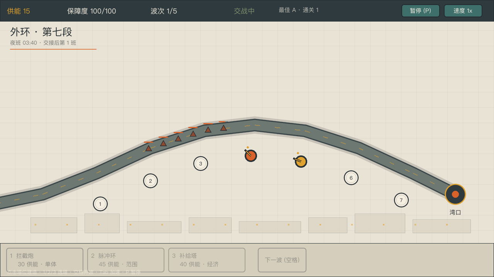
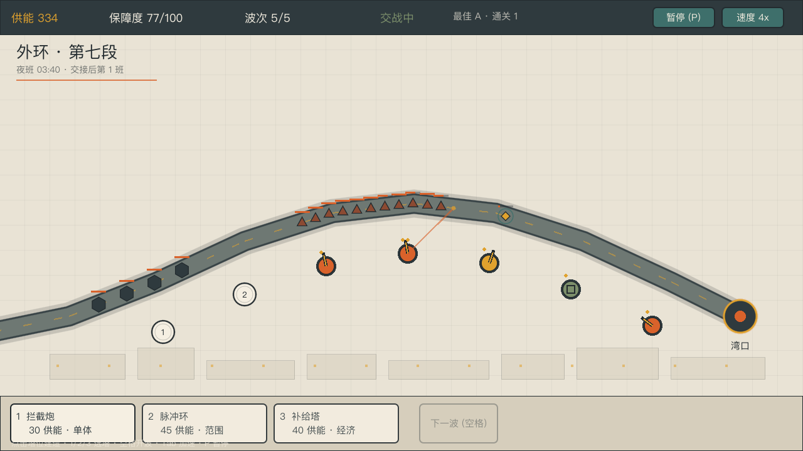
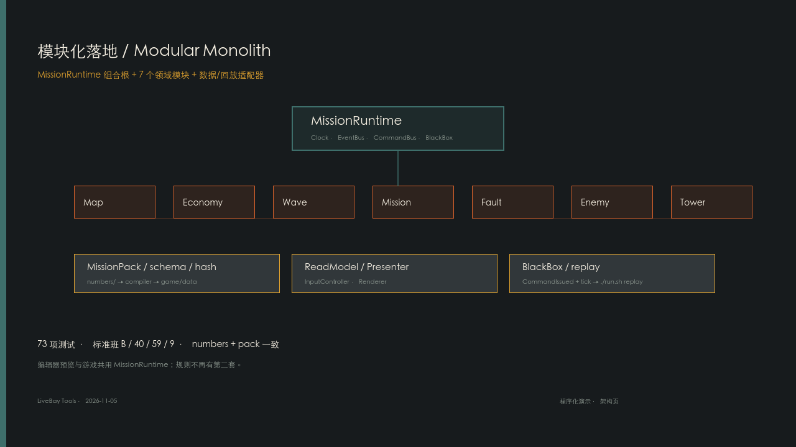

# LiveBay（逍遥湾）



[](docs-ai/design01/shots/v0.1_gameplay.mp4)

> **50 秒实机演示**（1280×720，H.264，无音频）：从第 1 波到第 5 波，包含建造、故障停塔、结算。点击画面播放。

## 编辑器演示

[](docs-ai/design01/shots/editor_usage_v2.mp4)

> **40 秒编辑器 + 模块化架构演示**（1280×720，H.264，无音频）：前 32 秒是编辑器操作，最后 8 秒是 MissionRuntime / 7 模块 / Pack / 回放架构页。  
> 这是程序化演示场景（[`game/demo/`](game/demo/README.md)），不是桌面录屏。  
> 旧版 32 秒编辑器视频保留：[`editor_usage.mp4`](docs-ai/design01/shots/editor_usage.mp4)。

## 目录

| 路径 | 是什么 | 谁维护 |
| --- | --- | --- |
| [`docs-human/`](docs-human/) | **人类原始设定**（项目宪法）；AI 只读，不改写 | 人类 |
| [`docs-ai/`](docs-ai/) | AI 生成的概念与策划参考；含 [design01 策划文档集](docs-ai/design01/README.md) | AI 起草，人类裁决 |
| [`game/`](game/) | Godot 工程与可运行切片 | 工程 |
| [`game/addons/livebay_tools/`](game/addons/livebay_tools/README.md) | **LiveBay Tools 编辑器插件**：地图/塔位拖动、射程预览、写回 numbers | 工程 |
| [`briefing/`](briefing/README.md) | **面向人**的 HUB / GUIDE / 主题 / 数据校验 | 设计主控 + 工程 |
| [`run.sh`](run.sh) | 统一入口（运行 / 编辑器 / 测试 / 检查） | 工程 |

## 快速开始

```bash
./run.sh          # 启动游戏
./run.sh editor   # 打开 Godot 编辑器
./run.sh test     # 无头模拟测试（83 项断言）
./run.sh verify   # 一键全量验收（测试/扩展/编辑器/试玩/生成物/链接/HTML）
./run.sh check    # 无头启动 180 帧，抓脚本错误
./run.sh pack-check # 校验 MissionPack 清单
./run.sh replay     # 回放最近一局黑匣子
./run.sh expansions-check # 校验扩展包/preset/变体互斥
./run.sh compare          # L1 A/B/C 对比表
./run.sh playtest         # 三张地图的无头试玩
./run.sh sim-trace        # 导出 Godot 标准场景对账 trace
./run.sh perf             # 性能基准（帧时间/实体/长跑/地图加载）
./run.sh simulator        # 生成数值沙盘
./run.sh simulator-check  # 校验数值沙盘是否过期
./run.sh flow             # 生成 flows/ 静态流程图
./run.sh flow-check       # 校验流程图是否过期
./run.sh briefing         # 从数据重新生成 briefing/GUIDE.html
./run.sh briefing-check   # 校验 GUIDE 与 HUB 数字/素材
./run.sh editor-test # 编辑器数据桥冒烟测试
./run.sh import   # 首次导入资源
```

首次运行前如未导入资源，先执行 `./run.sh import`。`HOME` 会自动指向工作区的 `games/.godot-home/`，不写用户目录。

## 当前能玩什么

- 3 张地图：外环第七段（7 塔位）、中环维护环（9 塔位，回环）、湾口对接臂（5 塔位，短路径）；三图各有独立波次表；
- 1 个示例职业：护湾卫兵；
- 4 种塔：拦截炮（单体）、脉冲环（范围 + 减速）、牵引锚（强减速）、补给塔（经济 + 维修）；
- 5 种敌人：碎片、乱流、重壳、装甲片，以及从湾口反向扩散、让塔短暂离线的「故障」（内部故障 C）；
- 5 波敌人，准备 / 交战 / 波间整备 / 胜负结算；
- 建造、升级、出售、暂停、1x/2x、最高记录存档；
- 无头测试可复现胜利与失败路径。

**操作**：鼠标点击塔位建造；点已有塔选中（U 升级 / X 出售）；`1/2/3` 选塔；空格开波；`P` 暂停；`Tab` 加速；`R` 重开。

## 开发工具

Godot 编辑器内置 **LiveBay Tools** 插件（`game/addons/livebay_tools/`）：在 2D 视口拖动路径点、塔位、基地，预览射程；用波次时间轴调组/波次、视口内嵌预览；保存时写回 `numbers/` 并导出。用法见 [`game/addons/livebay_tools/README.md`](game/addons/livebay_tools/README.md)。

## 文档入口

| 你想 | 去哪 |
| --- | --- |
| 先看项目导览 | [`briefing/HUB.html`](briefing/HUB.html) ｜ [玩法说明](briefing/GUIDE.html) |
| 看人类原始设定 | [`docs-human/概念设定.md`](docs-human/概念设定.md) |
| 看策划文档集总览 | [`docs-ai/design01/README.md`](docs-ai/design01/README.md) |
| 看 HTML 阅读版 | [`docs-ai/design01/html/index.html`](docs-ai/design01/html/index.html)（支持系统 / 浅色 / 深色） |
| 看还需要你拍板什么 | [`docs-ai/design01/11_待人类裁决清单.md`](docs-ai/design01/11_待人类裁决清单.md) |
| 看 NASA朋克美学 | [`docs/retro-futurism/附录_NASA朋克卷/`](../../docs/retro-futurism/附录_NASA朋克卷/README.md) |
| 调数值 / 看覆盖 | [`docs-ai/design01/simulator/index.html`](docs-ai/design01/simulator/index.html) |
| 看一局流程图 | [`docs-ai/design01/flows/game_flow.html`](docs-ai/design01/flows/game_flow.html) ｜ [补充流程图](docs-ai/design01/flows/extra_flows.html) |
| 看工程结构 | [`docs-ai/design01/tech/12_技术方案_Godot工程.md`](docs-ai/design01/tech/12_技术方案_Godot工程.md) |
| 看数值体系 | [`docs-ai/design01/numbers/README.md`](docs-ai/design01/numbers/README.md) |
| 看艺术设定图 | [`docs-ai/design01/art/README.md`](docs-ai/design01/art/README.md) |
| 看小说集 | [`docs-ai/design01/fictions/README.md`](docs-ai/design01/fictions/README.md) |
| 看规则体系 | [`docs-ai/design01/rules/README.md`](docs-ai/design01/rules/README.md) |
| 看规则总览（HTML） | [`docs-ai/design01/html/rules/index.html`](docs-ai/design01/html/rules/index.html) |
| 看改了什么 | [`CHANGELOG.md`](CHANGELOG.md) |

## 设计状态

**2026-11-03 已裁决 P0（六项）**（完整记录见 [11_待人类裁决清单](docs-ai/design01/11_待人类裁决清单.md)）：

| ID | 裁决 |
| --- | --- |
| D01 基调 | **B 有裂缝的善意**：体系有效，但以排除少数人为代价 |
| D02 敌人 | **D 混合；首版 A（自然）+ C（内部）**；工程已实现 A+C |
| D03 三生 | **生存 / 生活 / 生产**；慢好 = **慢 + 好** |
| D05 第一职业 | **护卫兵 v0.1；护理师 v0.2** |
| D16 范围 | **垂直切片**：先验证 10 分钟闭环 |
| D04 主角 | **C 无名岗位人**：每个职业都是「你」，情感由湾民档案建立 |

**P0 已清空；P1 也已裁决：**

| ID | 裁决 |
| --- | --- |
| D06 航行代际 | **200 年（第七代）** |
| D07 治理 | **双轨**：日常算法 / 危机议会 |
| D08 裂缝 | **低报事故**（只埋线索） |
| D09 塔防形态 | **弧形路径**（已实现） |
| D10 失败处理 | **重试 + 可跳过复盘**（已实现） |
| D11 三玩法耦合 | **v0.1 L0；v0.2 L1** |
| D12 商业模式 | **买断 + 内购**（仅外观/扩展，不卖数值） |
| D13 美术 | **2D 矢量 / 程序化**（当前占位） |
| D15 叙事量 | **中** |

**只剩 P2**：D14 平台、D17 更新节奏、D18 语言，见 [11](docs-ai/design01/11_待人类裁决清单.md)。

当前工程里的**所有中文名词与数值仍是【工程占位】**，不是最终平衡。改设定优先改 `game/data/*.json`，不需要重写代码。

## 边界

- 本项目的**人类意图**只在 [`docs-human/`](docs-human/)；AI 生成的策划文档在 [`docs-ai/`](docs-ai/)，标记为「参考，非决定」。
- `docs-ai/` 里的候选不自动成为设定；未裁决前，工程只做可逆占位。
- 工程性文档（本 README、[`CHANGELOG.md`](CHANGELOG.md)、代码注释）不放在 `docs-ai/`。

## 素材与许可

- 当前画面全部由 Godot 程序化绘制，无外部美术资源；
- 字体使用系统字体回退（PingFang / Noto Sans CJK / 微软雅黑）；
- 短音效已接入；音乐尚未接入。
