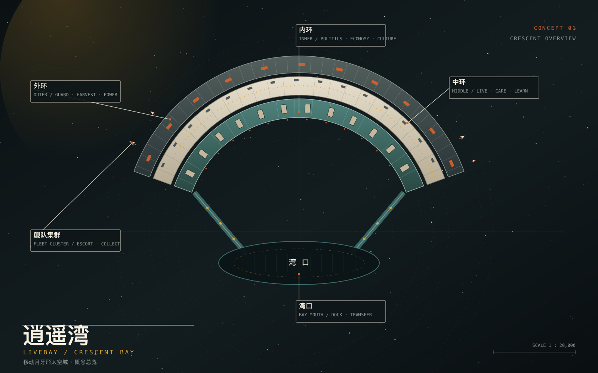
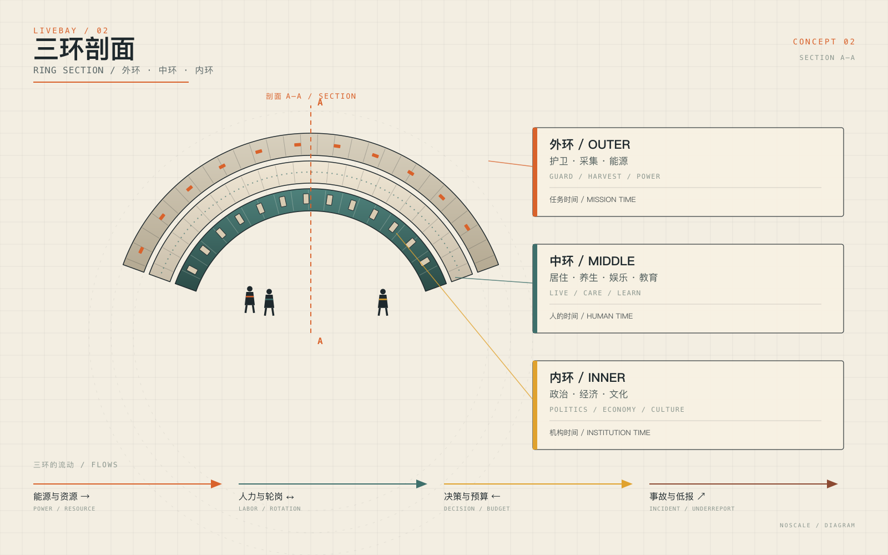
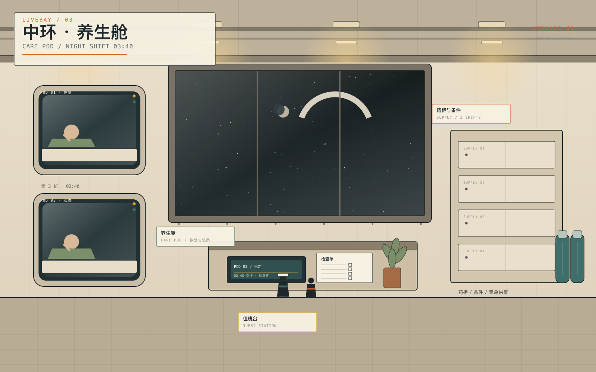
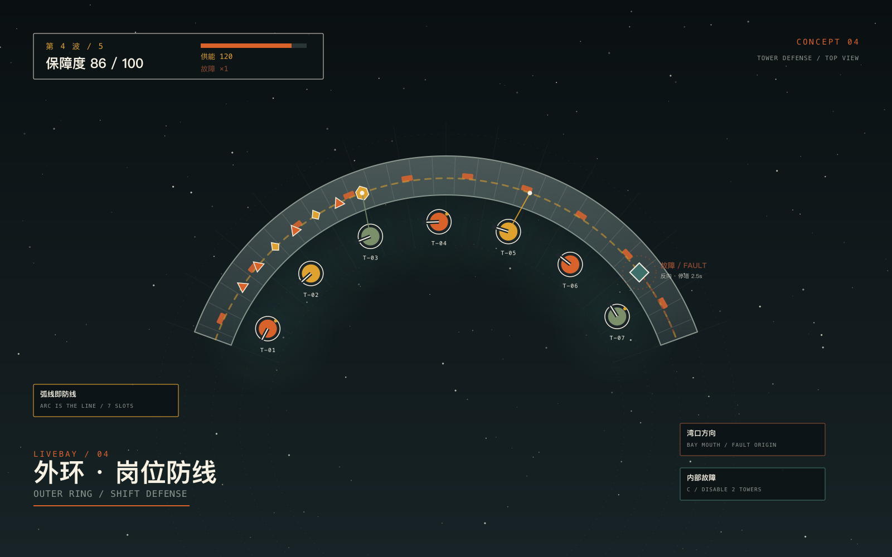
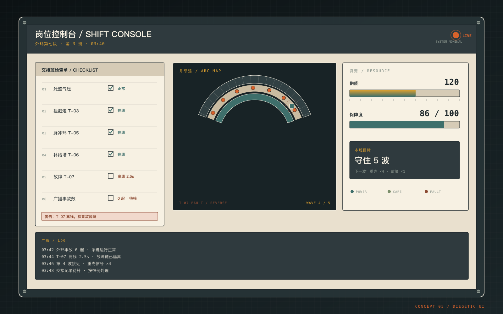
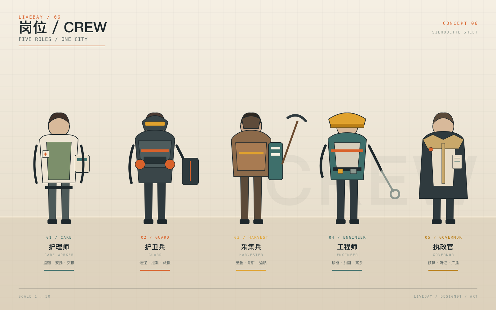

# LiveBay 艺术设定图

> 六张概念设定图，用来把「NASApunk / 月牙城 / 岗位感」从文字变成可看的图像。**这些是方向提案，不是最终美术**；角色比例、细节与配色都可以被推翻。

## 01 · 月牙城总览



- 三环从外到内：外环护卫/采集/能源，中环居住/养生/娱乐/教育，内环政治/经济/文化；
- 月牙的凹面是湾口，用两条对接臂连接城市与港湾；
- 外环的橙色夹点表示可维修的模块接口，中环的琥珀点是居住舱窗灯；
- 背景保留大量留白，让城市像一件漂浮的工程物件，而不是主题公园。

## 02 · 三环剖面



- 把三环拆成可读的剖面：外环=任务时间，中环=人的时间，内环=机构时间；
- 右侧面板不是图例，而是「这一环在保障什么」；
- 底部的四条流：能源与资源、人力与轮岗、决策与预算、事故与低报；
- 适合作为世界观与关卡结构的对读图。

## 03 · 中环 · 养生舱



- 夜班 03:40，护理师在巡检，湾民在恢复舱里睡着；
- 舱体是「可维修的白盒」：外露框架、状态灯、检查单、药柜、备件；
- 暖白 + 鼠尾草绿 + 琥珀光，和外环的冷灰/橙色形成对比；
- 窗外的月牙城提醒：这是一个仍在航行中的封闭空间。

## 04 · 外环 · 岗位防线



- 七个塔位沿弧内侧展开，射程圈与弧线的关系一眼可见；
- 故障从湾口方向反向扩散，标出「停塔 2.5 秒」的代价；
- HUD 只保留四个数：波次、保障度、供能、故障数；
- 这张图同时是关卡结构图与玩法说明图。

## 05 · 岗位控制台



- 交接班检查单、月牙弧地图、资源条、广播日志；
- 界面是「世界的一部分」：纸张、金属框、螺钉、琥珀警报；
- 检查单上故意留了一项「广播事故数：0 起 · 待核」，对应 D08 的低报事故；
- 适合作为 UI 风格与信息层级的参考。

## 06 · 岗位 / CREW



- 五个岗位：护理师、护卫兵、采集兵、工程师、执政官；
- 每人一条色带与一个工具，不靠脸识别，而靠岗位识别；
- 比例是剪影设定，不是最终角色立绘；
- 对应 D04「无名岗位人」：玩家不是某个固定英雄，而是这些岗位之一。

## 视觉规则

| 项 | 用法 |
| --- | --- |
| 暖白 / 米白 | 舱壁、纸张、面板 |
| 安全橙 | 警示、活动部件、外环接口 |
| 深青 / 灰绿 | 设备、结构、内环 |
| 琥珀 | 警报、状态灯、居住舱窗灯 |
| 深灰 / 石墨 | 结构、文字、边框 |
| 字号 | 标题用宋体/无衬线，数据用等宽 |

比例建议：**70% 中性 + 20% 深色结构 + 10% 高饱和强调**。橙色只出现在「需要被看见」的地方。

## 文件与再生成

| 文件 | 说明 |
| --- | --- |
| `images/01_crescent_bay_overview.svg` | 矢量源文件 |
| `images/02_ring_section.svg` | 矢量源文件 |
| `images/03_care_pod.svg` | 矢量源文件 |
| `images/04_outer_defense.svg` | 矢量源文件 |
| `images/05_shift_console.svg` | 矢量源文件 |
| `images/06_crew.svg` | 矢量源文件 |
| `*.png` | 1600×1000 导出图 |

```bash
cd games/livebay
python3 tools/make_art.py      # 重新生成 SVG
./tools/render_art.sh          # SVG -> PNG（需要 rsvg-convert）
```

## 边界

- 图里的中文标签是概念说明，不是最终游戏内文案；
- 没有使用外部图片或第三方素材，全部由 SVG 程序化绘制；
- 这些图不替代 [`08_美术与音频方向`](08_美术与音频方向.md) 的规则，只提供视觉锚点；
- 人类如果改变风格方向，先改 08 与 NASApunk 附录卷，再重画这组图。
