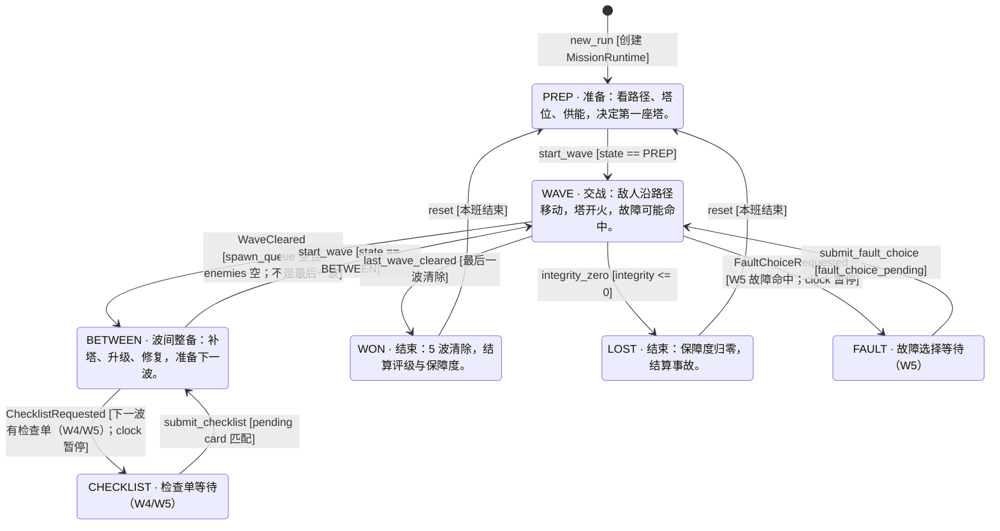

# LiveBay · 一局静态流程图

> 由 `tools/build_flow.py` 生成；状态/命令/事件来自 `game/scripts/`，迁移模型人工维护。
> 检查单/故障等待态是流程层概念，不是 `Sim.State` 的枚举值。

## 迁移表

| 从 | 触发 | 到 | 类型 | 守卫 | 副作用 |
| --- | --- | --- | --- | --- | --- |
| [*] | `new_run` | PREP | system | 创建 MissionRuntime | clock / event bus / black box 初始化 |
| PREP | `start_wave` | WAVE | player | state == PREP | 生成第 1 波；玩家也可提前开波 |
| WAVE | `WaveCleared` | BETWEEN | system | spawn_queue 空且 enemies 空；不是最后一波 | 进入波间整备 |
| BETWEEN | `start_wave` | WAVE | player | state == BETWEEN | 生成下一波 |
| WAVE | `last_wave_cleared` | WON | system | 最后一波清除 | 结算 grade / integrity / kills |
| WAVE | `integrity_zero` | LOST | system | integrity <= 0 | 事故结算，可重试 |
| BETWEEN | `ChecklistRequested` | CHECKLIST | system | 下一波有检查单（W4/W5）；clock 暂停 | 打开检查单 UI |
| CHECKLIST | `submit_checklist` | BETWEEN | player | pending card 匹配 | 写入检查单结果；恢复 clock |
| WAVE | `FaultChoiceRequested` | FAULT | system | W5 故障命中；clock 暂停 | 打开隔离/旁路 UI |
| FAULT | `submit_fault_choice` | WAVE | player | fault_choice_pending | 应用隔离/旁路；恢复 clock |
| WON | `reset` | PREP | player | 本班结束 | 重开一班；保留接班记忆 |
| LOST | `reset` | PREP | player | 本班结束 | 重开一班；保留接班记录 |

## 代码事实

- 核心状态：`PREP, WAVE, BETWEEN, WON, LOST`
- 运行时等待态：`CHECKLIST, FAULT`
- 命令（10）：`build_tower, reset, sell_tower, set_pause, set_speed, start_wave, submit_checklist, submit_fault_choice, submit_report, upgrade_tower`
- 事件（25）：`ChecklistRequested, ChecklistResolved, CommandIssued, EnemyKilled, EnemyLeaked, EnergyChanged, FaultChoiceRequested, FaultEscaped, FaultResolved, IntegrityChanged, MissionReset, MissionStarted, PauseChanged, ReportSubmitted, ResultReady, SpeedChanged, TowerBuilt, TowerDegraded, TowerDisabled, TowerFired, TowerSold, TowerUpgraded, WaveCleared, WaveCommanded, WaveStarted`

## 怎么维护

1. 改状态/命令/事件后跑 `./run.sh flow`；
2. 迁移模型变了，改 `tools/build_flow.py` 的 `TRANSITIONS`；
3. `--check` 会校验生成物是否过期，以及命令/事件是否真实存在。
