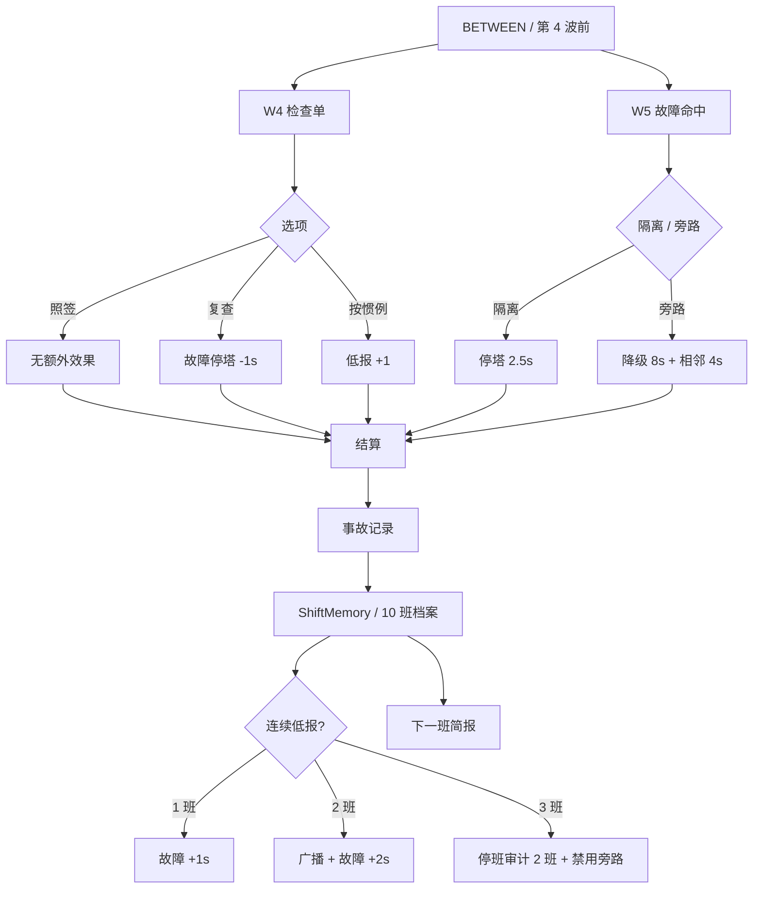

# L1 班次扩展流程

> 由 `tools/build_flow.py` 生成；配套总览见 [README.md](README.md)，总状态机见 [game_flow.md](game_flow.md)。

W4 检查单、W5 故障选择、结算记录、接班记忆与低报审计；这些是班次层样例，不是核心状态枚举。

## 说明

- 这张图是流程/结构图，不是数值平衡表；
- 图中的“等待/选项”是流程层概念，不一定是 `Sim.State` 的枚举值；
- 改状态/命令/事件后运行 `./run.sh flow` 重新生成。
