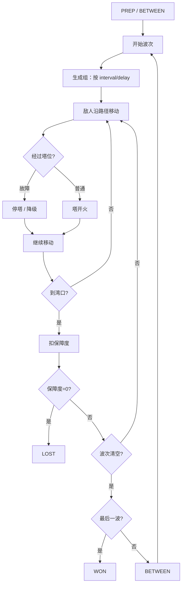

# 波次生命周期

> 由 `tools/build_flow.py` 生成；配套总览见 [README.md](README.md)，总状态机见 [game_flow.md](game_flow.md)。

从准备倒计时到生成、移动、命中/漏过、清除；最后一波进入 WON，保障度归零进入 LOST。

## 说明

- 这张图是流程/结构图，不是数值平衡表；
- 图中的“等待/选项”是流程层概念，不一定是 `Sim.State` 的枚举值；
- 改状态/命令/事件后运行 `./run.sh flow` 重新生成。
