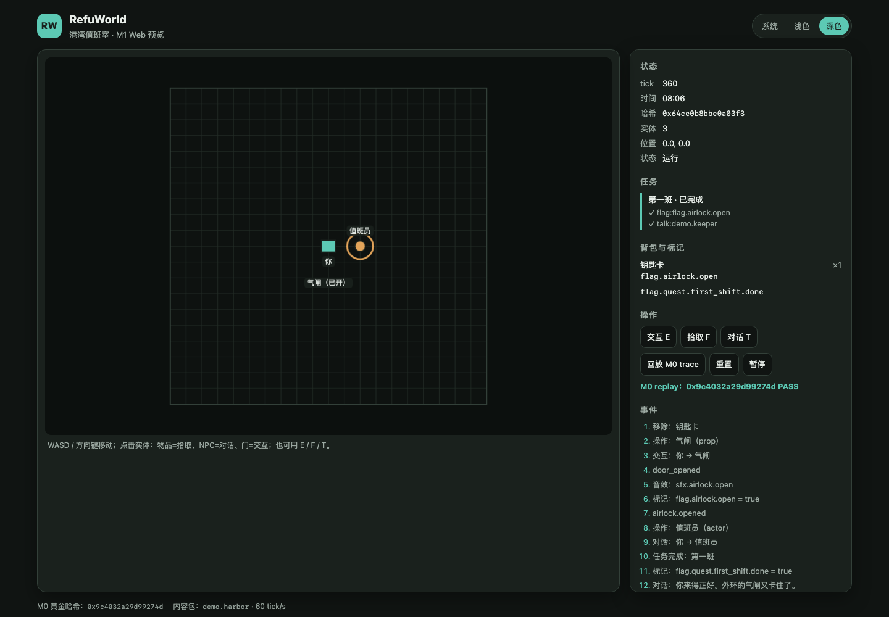
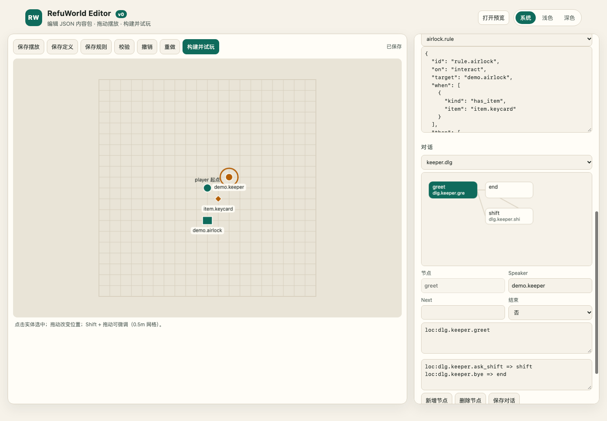
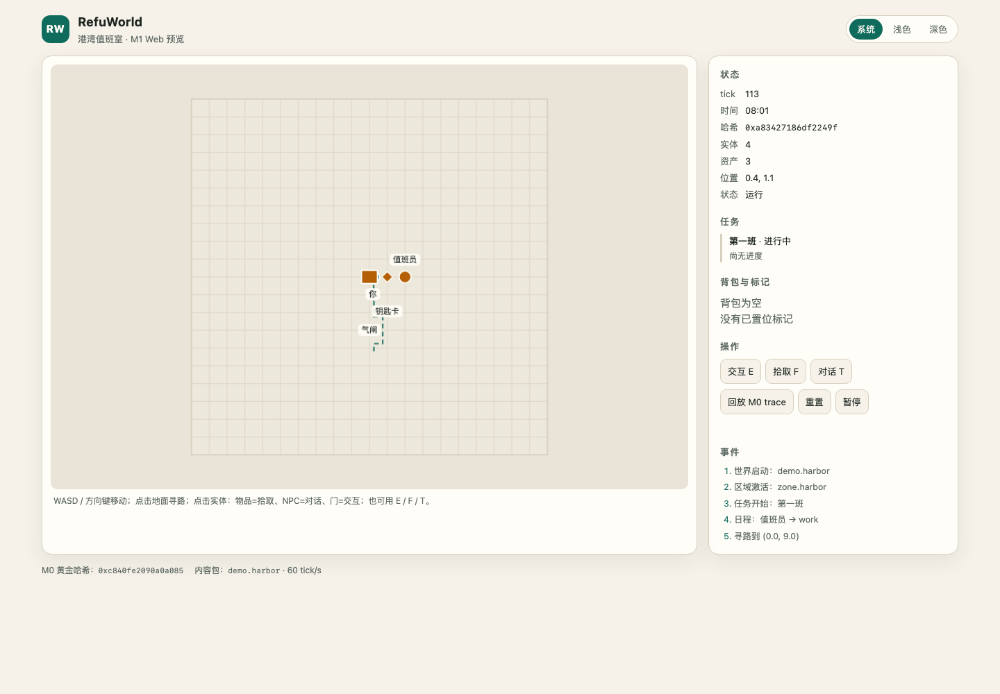
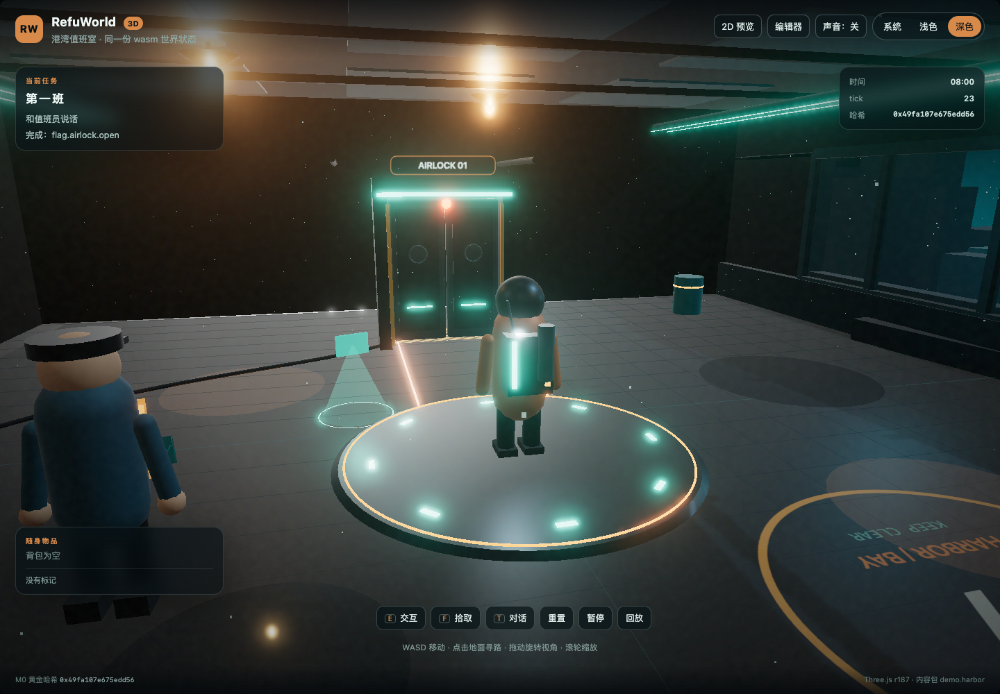
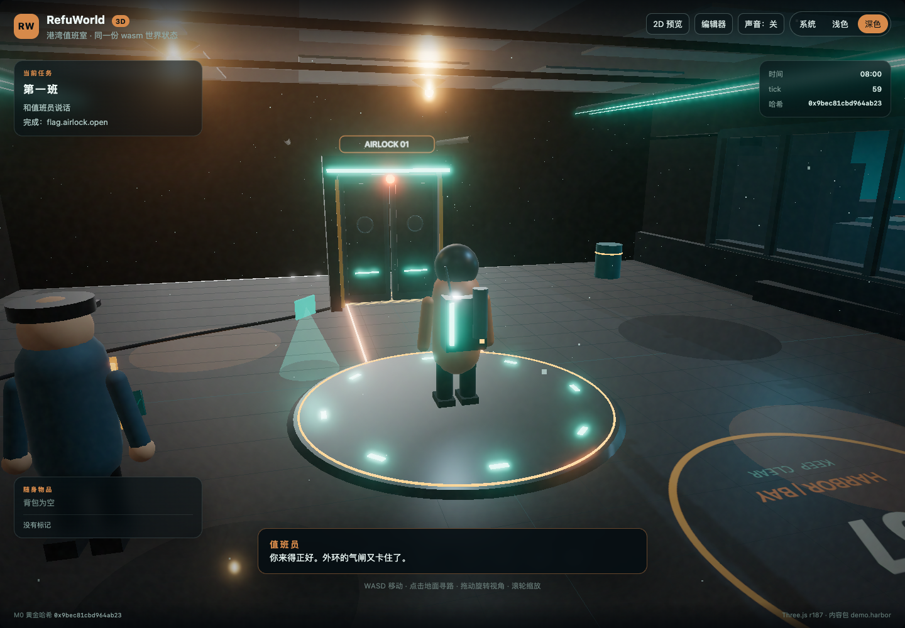
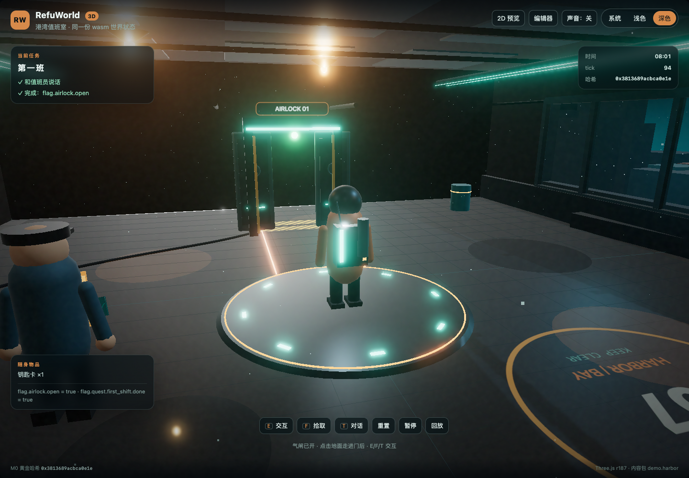
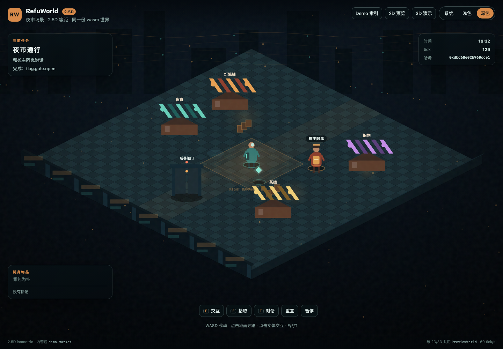
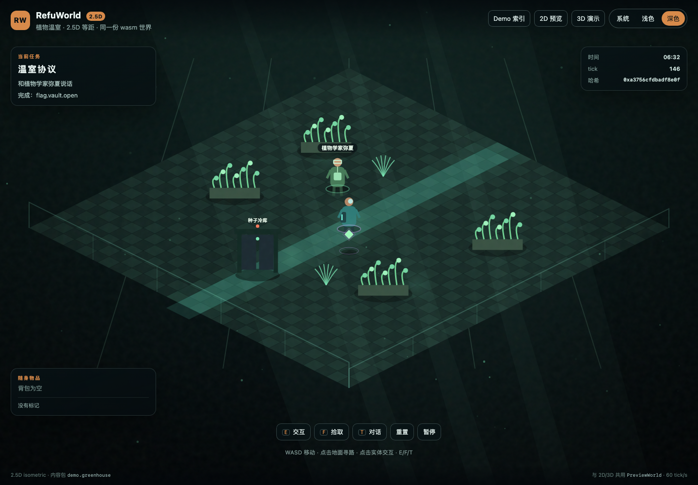
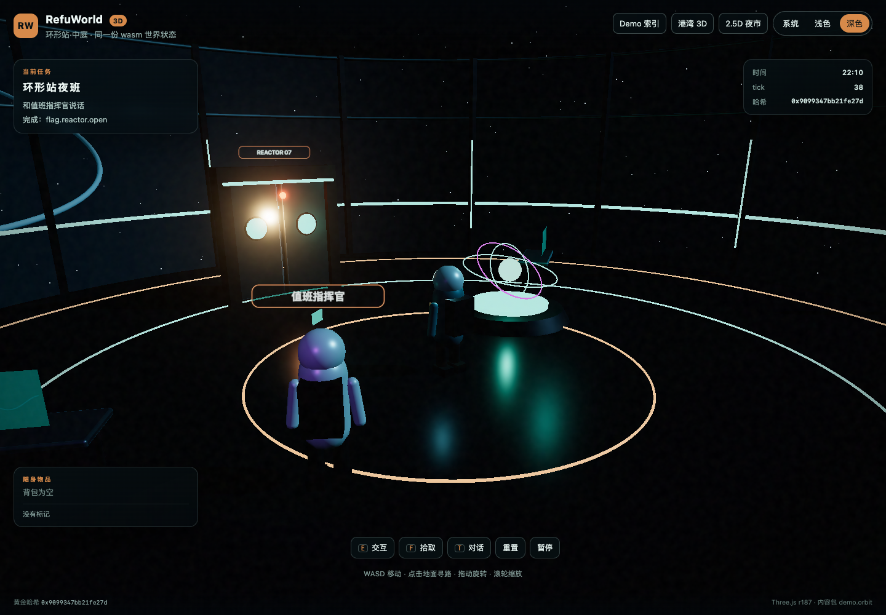

# 07 · M1 切片实现与验收（TS DSL + 2D/2.5D/3D Demo + 编辑器 v0.5 + 移动/导航/资产）

> **一句话**：M1 的核心闭环已经打通——TypeScript DSL 编译出的内容包与 JSON 包**同哈希**；
> Web 预览能移动、交互、完成任务并回放同一 `0x3606a221e9990561`；Web 编辑器能拖动摆放、改字段/规则/对话并构建试玩。

> **范围说明**：这是 **M1 主要切片**（TS DSL / Web 预览 / ScriptHost / 编辑器 v0.5 / 移动与寻路 / 导航/资产 / 内容测试）。
> 真实 5k v1 基准已完成（见 §4.9）；三平台 CI 已于 run 45757232197 实跑通过（含 expanded coverage，见 §5.4）；真实作者试用仍未完成。ScriptHost 已接入 QuickJS（事件作用域），见 §4.8。

## 一、结果

| 项 | 结果 |
| --- | --- |
| TS DSL 编译 | `src/content/demo.harbor/*.ts` → 规范化内容包 |
| 与 JSON 包一致 | 包哈希同为 `sha256:21569377…b7d5f9` |
| TS 包跑 M0 trace | `0x3606a221e9990561`，与 JSON 包一致 |
| wasm 预览逻辑 | Node 中 replay 与 600 tick 点击序列均 = `0x3606a221e9990561` |
| 浏览器实测 | 拾取 → 交互 → 对话，任务完成；回放 `PASS` |
| 移动/碰撞 | 玩家前进被关闭的气闸挡住（z=5.40）；开门后可通过 |
| 编辑器 v0.5 | 拖动摆放、字段表单、定义/规则 JSON、对话图、撤销/重做、校验/构建 |
| 类型检查 | `tsc --noEmit`（`worldc ts-check`）PASS |
| ScriptHost | QuickJS 事件上下文 → 命令；内存/栈/命令/中断预算；脚本错误隔离；wasm/C/CLI/headless 接入 |
| 内容测试 | 港湾 3 条 + 夜市/温室/环形站各 1 条，共 **17 条 PASS** |
| 5k 真实基准 | `worldc bench --scenario real5k`：5,000 初始实体、规则/任务/日程/脚本/导航；tick P95 **0.239 ms**、P99 0.580 ms、snapshot P95 3.086 ms（M1 Pro release，5×6000） |
| 导航 | `worldc bake nav` → 40×40 网格；A* + `MoveTo`；点击地面绕开门到达 z=9.33 |
| 资产 | `assets/assets.index.json` + `visual` 引用；`world_zone_assets` 返回 3 个逻辑资产 |
| Demo 体系 | 21 个玩法 Demo（2D/2.5D/3D）共用 wasm 状态；Demo 索引、2.5D 夜市/温室、3D 环形站 |
| 3D 港湾 | Three.js r187 + wasm 状态；第三人称、气闸开门、对话字幕、雨/海/灯塔、Bloom、程序化音效 |
| 主题 | `system/light/dark` 三态、`aria-pressed`、`lrds-theme` 持久化均实测 |
| 一键验收 | [`test/run_m1.sh`](../test/run_m1.sh) |

## 二、截图

浅色（任务已完成，回放 PASS）：


深色：



编辑器 v0.5：


对话图编辑器：



点击地面寻路（虚线为 A* 路径）：



3D 沉浸式演示（深色，初始）：



气闸开启 + 对话字幕：



## 三、TS DSL

### 3.1 作者写什么

```ts
// src/content/demo.harbor/rules.ts
import { defineRule } from "#world-authoring";

defineRule({
  id: "rule.airlock",
  on: "interact",
  target: "demo.airlock",
  when: [{ kind: "has_item", item: "item.keycard" }],
  then: [
    { kind: "open_door" },
    { kind: "play_sound", id: "sfx.airlock.open" },
    { kind: "set_flag", flag: "flag.airlock.open", value: true },
    { kind: "emit", event: "airlock.opened" },
  ],
  else: [{ kind: "toast", text: "loc:airlock.locked" }],
});
```

- 作者只写 `defineActor` / `defineProp` / `defineItem` / `defineZone` / `defineRule` / `defineQuest` /
  `defineDialogue` / `defineSchedule` / `definePack` / `defineWorld` / `defineLoc`。
- 类型定义在 [`packages/world-authoring/src/types.ts`](../packages/world-authoring/src/types.ts)。
- `#world-authoring` 由 [`package.json`](../package.json) 的 `imports` 映射到本地 TS 包，不需要 `node_modules`。

### 3.2 编译

```bash
cd games/world
node tools/ts-build.mjs --src src/content/demo.harbor --out dist/ts/demo.harbor
# 或
./worldc ts-build --compare data/demo.harbor
```

编译产物与 JSON 包结构完全相同：`pack.json`、`world/*.json`、`world/{zones,actors,props,items}/`、
`rules/`、`quests/`、`dialogue/`、`schedules/`、`loc/`。

### 3.3 实现方式与边界

- Node 24 直接执行带类型标注的 `.ts`（type stripping）；**类型检查另走 `tsc --noEmit`**：
  `./worldc ts-check` 或 `npm run check`（本地 devDependency，版本见 `package-lock.json`）。
- 编译器是一个小脚本 [`tools/ts-build.mjs`](../tools/ts-build.mjs)：注册表收集 → 检查必需定义/重复 ID →
  写规范化 JSON + `sourcemap.json` → 由 Rust `worldc` 校验/哈希。
- 开发监听：[`tools/dev-watch.mjs`](../tools/dev-watch.mjs)（`npm run dev`）编译 TS → 构建 → 复制 `web/pack.data`；
  预览由 `worldc editor` 提供时会自动刷新。

## 四、Web 预览

```bash
cd games/world
./web/build.sh
node tools/serve-web.mjs --port 8787
# http://127.0.0.1:8787/web/
```

### 4.1 架构

```text
data/demo.harbor → worldc build → dist/demo.harbor/pack.data
                                         │
world-wasm (wasm-bindgen) ── PreviewWorld ── web/pkg/world_wasm.js
                                         │
web/app.js ── 60 Hz tick / 点击·键盘命令 / Canvas 2D / HUD / 事件日志
```

- [`world-wasm`](../code/crates/world-wasm/src/lib.rs) 把 `World` 包成 JS 对象：
  `tick`、`pause`、`interact`、`talk`、`pickup`、`command`、`state`、`poll_events`、`replay`、`reset`。
- `state()` 返回只读快照 + 名称/文案/区域边界；`poll_events()` 返回事件 JSON。
- 预览不经过 C ABI（它直接链接 `world-core`），因为它是作者工具，不是引擎适配器；
  引擎适配器仍走 C ABI。这条边界要在 M1 编辑器阶段继续保持。

### 4.2 操作

| 操作 | 方式 |
| --- | --- |
| 移动 | `WASD` / 方向键；圆形玩家 vs 圆形/AABB 障碍 |
| 拾取 | 点击黄色菱形 / `F` |
| 对话 | 点击绿色圆点 / `T` |
| 交互 | 点击橙色方块 / `E` |
| 暂停 / 重置 | `P` / `R` |
| 回放 M0 trace | 按钮；显示 `PASS/FAIL` 与哈希 |

> 移动是 60 Hz 运动学：`speed / tick_hz` 每 tick 位移，先 X 后 Z 分轴解析碰撞；关闭的门与 NPC 会挡路，打开的门不挡。
> 没有跳跃、重力、斜坡或引擎物理；目标仍在 8 米内可交互。

### 4.3 主题

按 [R-016](../../../design/rules/R-016-html-theme-modes.md)：

- 默认 `system`；`localStorage['lrds-theme']` 持久化；
- CSS 加载前内联预绘制；
- 三态按钮可键盘访问，当前项 `aria-pressed="true"`；
- 系统态监听 `prefers-color-scheme`；
- 打印强制浅色；
- 无 JS 时内容可读，主题控件隐藏（不显示假控件）。

### 4.4 编辑器 v0.5

```bash
cd games/world
./worldc editor --port 8788
# http://127.0.0.1:8788/
```

- 编辑对象是 `data/demo.harbor` 的 **JSON 包**（TS 源不会自动同步；两种前端各自编译到同一规范包）。
- 布局：Canvas 中拖动 placement，0.5m 网格（Shift 0.1m），实时写回 `at`。
- 数据：选中实体后编辑 X/Z/Yaw/Persistent ID；字段表单可改 name/tags/health/speed/dialogue/schedule（actor）、
  locked_by/verbs（prop）、stack（item），也可直接编辑定义 JSON。
- 对话：对话图（节点/边）可点击选中；编辑 speaker/text/next/end 与选项（每行 `text => next`），
  支持新增/删除节点与保存。
- 撤销/重做：拖动/表单/JSON/对话修改都进 undo 栈；按钮或 `Cmd/Ctrl+Z`、`Cmd/Ctrl+Shift+Z`。
- 规则：选择 `rules/*.json`，直接编辑 JSON 并保存。
- 校验：调用 `worldc validate`，把错误码/路径/信息回显；每次保存先写后校验，失败自动回滚（HTTP 422）。
- 构建并试玩：保存当前编辑 → `worldc bake nav` → `worldc build` → 复制 `pack.data` 到 `web/` → 打开 `/index.html`。
- 预览页面每 1.5s 轮询 `/api/pack-version`；编辑器构建后自动刷新（热重载的最小实现）。

> v0.5 是「表单 + 对话图 + 原始 JSON + 摆放拖拽」；还不是完整 schema 驱动表单/复杂对话图；见 §七。
> 服务器只绑定 `127.0.0.1`，无鉴权，供本机开发。

### 4.5 导航烘焙与资产依赖

```bash
cd games/world
./worldc bake nav --pack data/demo.harbor
# bake: world/nav/nav.harbor.json zone=zone.harbor size=40x40 blocked=4 cell=1
```

- 烘焙输入是 Zone 的边界 + 静态 Prop 的 AABB（按玩家半径 0.35 膨胀）；输出 `world/nav/<id>.json`。
- 运行期 A* 是 4 邻接、`(f, index)` 排序，确定性；`Command::MoveTo` 把路径写入 `path/path_index`，
  `apply_movement` 逐 waypoint 移动，WASD 直接输入会取消路径。
- 快照包含 `path`/`path_index`，所以路径也进入状态哈希；寻路测试从 `(0,0)` 到 `(0,9)` 绕开气闸到达 z=9.33。
- 预览点击空地即 `move_to`，绘制虚线路径；点击实体仍是交互。
- 编辑器工具栏「烘焙导航」调用 `POST /api/bake`；「构建并试玩」也会先烘焙再构建。

资产：
- `pack.json.assets` 指向 `assets/assets.index.json`；演员/道具/物品的 `visual` 引用逻辑资产 ID。
- 校验会拒绝不存在的 `visual`/`zone.nav`/`nav.zone`。
- `world_zone_assets("zone.harbor")` 返回该区域 placement 去重后的资产 ID：`mesh.airlock`、`mesh.keeper`、`mesh.keycard`。
- Demo 的资产源是占位路径（`art/*.glb`、`audio/*.ogg`），M1 只验证逻辑依赖，不校验文件存在。

### 4.6 3D 沉浸式演示

```bash
cd games/world
./web/build.sh
node tools/serve-web.mjs --port 8787
# http://127.0.0.1:8787/web/demo3d.html
```

- **同一份世界**：3D 页用同一个 `PreviewWorld`、同一份 `pack.data`；3D 只是表现，不复制玩法规则。
  页面底部仍显示黄金哈希 `0x3606a221e9990561`。
- **本地 Three.js**：`web/vendor/three` 内置 r187（MIT），import map 指向本地文件，不依赖 CDN。
- **场景**：程序化港湾值班室——海面/雨/远处货轮/灯塔、舷窗、气闸、钥匙卡、NPC、控制台、管线、地面导引线、
  湿地面反光、体积光、Bloom、雾、尘埃、电影感暗角与颗粒。
- **交互**：第三人称跟随 + 鼠标轨道/滚轮；WASD 或点击地面（A* 路径）；点击 NPC/气闸/卡，或 E/F/T；
  `open_door` 时双门滑开、状态灯变绿、点光变色；对话以字幕条出现。
- **主题**：R-016 三态；深色是夜间值班室，浅色会抬高环境光/材质色（不是简单反色）。
- **声音**：可选按钮生成雨声 + 低频机房嗡鸣（WebAudio，默认关，需用户手势）。
- **性能**：1024 阴影、Bloom、约 1.2k 雨点 + 260 尘埃；WebGL2 软渲染也能跑截图，实际 GPU 更流畅。

气闸开启：



2.5D 霓虹夜市：



2.5D 温室协议：



3D 环形站：



### 4.7 多 Demo 体系：2D / 2.5D / 3D

```bash
cd games/world
./web/build.sh
node tools/serve-web.mjs --port 8787
# http://127.0.0.1:8787/web/demos.html
```

`web/build.sh` 现在构建 **14 个内容包**，输出到 `web/packs/*.data`；每个 Demo 都是真实的 wasm 世界，不是静态截图。新增的 10 个 2D 场景覆盖库存、门禁、任务、日程与 ScriptHost（`demo.archive`）：

| Demo | 视图 | 内容包 | 玩法/场景 |
| --- | --- | --- | --- |
| 港湾值班室 | 2D 俯视 | `demo.harbor` | 剧情 / 交互 / 气闸 / 600 tick 回放 |
| 港湾值班室 · 3D | 3D 第三人称 | `demo.harbor` | 沉浸 / 滑门 / 对话字幕 / 雨海灯塔 |
| 霓虹夜市 | 2.5D 等距 | `demo.market` | 剧情 / 摊主 / 筹码 / 后巷闸门 |
| 温室协议 | 2.5D 等距 | `demo.greenhouse` | 探索 / 植物学家 / 样本 / 种子冷库 |
| 环形站·中庭 | 3D 第三人称 | `demo.orbit` | 探索 / 指挥官 / 徽章 / 反应堆闸门 |

- **一个索引页**：`web/demos.html` 提供 2D/2.5D/3D/剧情/探索筛选；卡片直达各 Demo。
- **2.5D 渲染器**：`web/iso.html` + `iso.js`，Canvas 等距投影；同一套 `PreviewWorld` 状态、A* 点击寻路、E/F/T、任务/背包 HUD；夜市与温室共用渲染器，只换内容包与色调。
- **3D 环形站**：`web/orbit3d.html` + `orbit3d.js`；星空/行星/环形玻璃中庭/全息台/反应堆闸门；同一套 C ABI 契约与 wasm 状态。
- **内容**：三个新包都有 `world/nav`、规则、对话、任务与内容测试；`worldc content-test` 全部 PASS。
- **边界**：2.5D/3D 是表现层；新增 Demo 不改 `world-core`，也不复制玩法规则。

### 4.8 ScriptHost：QuickJS 事件 → 命令

```bash
cd games/world
./test/run_m1.sh
# 或在浏览器/2.5D/3D 里打开 demo.orbit：交互反应堆后脚本写 flag
```

- **边界**：`world-core` 只定义 `ScriptHost { on_event(context_json) -> Vec<Command> }`；`world-script` 用 QuickJS 实现。
  核心不依赖 QuickJS，宿主负责注入。
- **内容**：`<pack>/scripts/*.js` 每个文件定义 `function onEvent(ctx) { ... }`；`data/demo.orbit/scripts/reactor.js`
  监听 `reactor.opened`，返回 `set_flag` + `toast`。
- **上下文**：`tick / event / flags / quests / entities / player / zone_id`；脚本用 content ID 查实体，用实体 `id` 返回命令。
- **命令**：`interact/talk/pickup/give_item/set_flag/start_quest/toast/play_sound/emit/activate_zone/move/move_to/open_door`。
- **预算/隔离**：QuickJS 内存 16 MB、栈 1 MB、单事件最多 128 条命令、20k 次中断计数；脚本异常变成
  `script_error` 事件与 `last_error`，不让脚本 panic 杀世界。
- **宿主**：`world-wasm`、`world-ffi`、`world-cli`、`world-host-headless` 在加载含 scripts 的包时注入；
  浏览器 wasm 需要 `env` 的 host time shim（`web/vendor/quickjs-env.js`，返回 0，保持确定性）。
- **验证**：`world-script` 5 个单元测试；`web/test_script_host.cjs` 在 wasm 中验证 `flag.script.reactor_seen`；
  `content-test --pack demo.orbit` 也断言脚本 flag。
- **边界**：M1 脚本是事件作用域；没有持久脚本状态、模块 import、异步调度、墙钟抢占与热重载。这些是后续 hardening，不是当前 M1 的核心闭环。

### 4.9 真实 5k v1 基准

```bash
cd games/world
WORLDC_RELEASE=1 ./worldc bench --scenario real5k --ticks 6000 --runs 5 --json
```

- 场景：`Pack::real5k(seed)`，**单 Zone 5,000 实体**（2,999 静态 Prop、1,500 带日程 Actor、500 Item、玩家）；
  20 规则/20 任务/10 对话/10 日程/2 脚本/240×240 导航。
- 工作负载：每 6 tick `MoveTo`、每 20 tick 交互/对话/拾取、每 120 tick 脚本 pulse、每 tick 查询、
  每 60 tick snapshot/hash、每 600 tick save/load；warmup 300，5 轮×6000。
- 测量边界：tick 只统计 `tick_once`；query/snapshot/save/load 分开。
- 基线：tick P50/P95/P99 = 0.184/0.239/0.580 ms，max 51.389 ms（首轮冷启动）；
  snapshot/hash P95 3.086 ms；save/load P95 7.287/12.737 ms；final hash `0x523160a40071cef5`。
- 结论：slab 在 v1 mixed load 下 P95 远低于 2 ms；不触发 `bevy_ecs` 替换。
- 边界：不是 5k 个 NPC 每 tick 决策/寻路，也不是多 Zone 驻留；v2 由真实 Adapter 触发。
- 记录：[ADR-008](../plans/ADR-008-real-5k-benchmark.md)、[baseline](bench/real5k-baseline-m1pro.json)。

## 五、验收证据

### 5.1 命令行

```text
ts-check: PASS
ts-build: pack_hash: sha256:21569377fffb1e19d945f488a61719c7401d3e7b4f1aac6033a621df00b7d5f9
compare: PASS（与 data/demo.harbor 一致）
test: demo.harbor ticks=600 hash=0x3606a221e9990561
content-test: first_shift PASS
content-test: airlock_locked_without_key PASS
content-test: pickup_keycard PASS
content-test: night_market / greenhouse / reactor PASS
script_host flag=true events=...reactor.opened,flag_changed,toast
editor smoke PASS
demo3d static PASS
bake: world/nav/nav.harbor.json size=40x40 blocked=4
wasm preview: replay=0x3606a221e9990561 preview=0x3606a221e9990561 movement z=5.40 path z=9.33 assets=3
```

### 5.2 浏览器（Chrome headless + CDP）

- 初始渲染：tick、时间、哈希、实体数、任务、事件均可见；
- 点击「拾取 F」→「交互 E」→「对话 T」后，任务显示「第一班 · 已完成」，
  目标 `flag:flag.airlock.open` 与 `talk:demo.keeper` 都打勾；
- 背包显示「钥匙卡 ×1」；
- 「回放 M0 trace」显示 `0x3606a221e9990561 PASS`；
- 主题按钮 `dark/light/system` 分别得到 `data-theme=dark/light/light`、`data-theme-choice` 当前项正确、
  `aria-pressed=true`，`localStorage['lrds-theme']` 最终为 `system`。
- 编辑器：`GET /api/pack` 加载 15 个文件；`PUT /api/file` 改 placement；非法引用返回 422 并回滚；`POST /api/validate` 0 错；`POST /api/build` 成功。
- 编辑器 v0.5：字段表单改 actor health；对话图选中 `greet` 并改 text；保存对话；撤销/重做恢复正确状态。
- 导航：点击空地后路径虚线出现，玩家绕开气闸；C ABI `world_zone_assets` 返回 3 个 ID。
- Demo：2.5D 页面点击/键盘交互、拾取/对话/开门；3D 环形站启动、徽章/指挥官/反应堆；Demo 索引筛选。
- 3D：Chrome + SwiftShader 实测场景启动、`loading` 消失；点击地面产生 `寻路到 …`；拾取钥匙卡 → 交互气闸后
  面板滑开、状态灯变绿、`flag.airlock.open = true`；对话显示字幕。

### 5.3 教程

[`08 · 两小时教程`](08_两小时教程.md) 按「区域 → 角色日程 → 物品/门 → 规则 → 对话图 → 任务 → 测试」组织；
功能已实现，但**真实作者计时试用还没做**，所以教程标「目标 2 小时」而不是已证实的平均值。

### 5.4 GitHub Actions 三平台实跑

- 提交：`7e4010e5`（`origin/main` 一致；workflow 已更名 `world.yml`）
- Run：[`45757232197`](https://github.com/andyluss/LiveRefu/actions/runs/45757232197) · **success** · 1m13s
- 结果：8 个 job 全绿——Ubuntu / macOS / Windows 三个 `cargo test`、C ABI、web preview（9 页 + Demo 静态契约）、wasm core、real5k benchmark、`world-wasm` + QuickJS。
- 覆盖：14 个内容包、R-016 10 页、real5k release smoke（CI 只校验不变量）、带 QuickJS 的 world-wasm wasm 构建。
- 结论：**三平台 CI 实跑 + 覆盖率补强已完成。**
- 仓库级 `.github/workflows/verify.yml` 在同提交另有失败（0s、jobs 为空），与本三平台 workflow 独立；不要把两者混为一谈。

## 六、文件

| 路径 | 作用 |
| --- | --- |
| [`package.json`](../package.json) | `#world-authoring` import map、`check`/`dev` 脚本 |
| [`tsconfig.json`](../tsconfig.json) | TypeScript 类型检查配置 |
| [`packages/world-authoring/`](../packages/world-authoring/) | 类型化 DSL 与注册表 |
| [`src/content/demo.harbor/`](../src/content/demo.harbor/) | TS 版「港湾值班室」 |
| [`tools/ts-build.mjs`](../tools/ts-build.mjs) | TS → 规范化内容包编译器（含 sourcemap） |
| [`tools/dev-watch.mjs`](../tools/dev-watch.mjs) | TS 内容开发监听 |
| [`tools/editor-server.mjs`](../tools/editor-server.mjs) | 本地编辑器服务器（读/写/校验/构建/回滚） |
| [`code/crates/world-core/src/nav.rs`](../code/crates/world-core/src/nav.rs) | 确定性 4 邻接 A* |
| [`code/crates/world-wasm/`](../code/crates/world-wasm/) | wasm 预览门面 |
| [`web/`](../web/) | 2D 预览 + 3D 演示 + 编辑器页面、构建脚本、Node 测试 |
| [`web/demo3d.html`](../web/demo3d.html) / [`demo3d.js`](../web/demo3d.js) | 3D 港湾演示（同一 wasm 状态） |
| [`web/demos.html`](../web/demos.html) / [`gallery.css`](../web/gallery.css) | Demo 索引与筛选 |
| [`web/iso.html`](../web/iso.html) / [`iso.js`](../web/iso.js) | 2.5D 等距渲染器（夜市/温室） |
| [`web/orbit3d.html`](../web/orbit3d.html) / [`orbit3d.js`](../web/orbit3d.js) | 3D 环形站场景 |
| [`data/demo.market/`](../data/demo.market/) / [`demo.greenhouse/`](../data/demo.greenhouse/) / [`demo.orbit/`](../data/demo.orbit/) | 三个新 Demo 内容包 |
| [`web/vendor/three/`](../web/vendor/three/) | 本地 Three.js r187（MIT） |
| [`data/demo.harbor/world/nav/`](../data/demo.harbor/world/nav/) | 烘焙后的导航网格 |
| [`data/demo.harbor/assets/`](../data/demo.harbor/assets/) | 逻辑资产索引 |
| [`data/demo.harbor/tests/`](../data/demo.harbor/tests/) | 内容测试与 M0 trace |
| [`code/crates/world-pack/src/bench.rs`](../code/crates/world-pack/src/bench.rs) | `Pack::real5k` 确定性 5k 场景生成器 |
| [`code/crates/world-cli/src/bench_real5k.rs`](../code/crates/world-cli/src/bench_real5k.rs) | real5k workload driver（P50/P95/P99、query/snapshot/save/load） |
| [`plans/ADR-008-real-5k-benchmark.md`](../plans/ADR-008-real-5k-benchmark.md) / [`docs/bench/`](bench/) | 基准决策与 M1 Pro 基线 |
| [`test/run_m1.sh`](../test/run_m1.sh) | M1 一键验收 |
| [`test/editor_smoke.mjs`](../test/editor_smoke.mjs) | 编辑器服务器保存/校验/构建冒烟 |
| [`test/demo3d_static.mjs`](../test/demo3d_static.mjs) | 3D 本地依赖/import map/R-016 静态契约 |
| [`08_两小时教程.md`](08_两小时教程.md) | 作者教程（真实作者试用待做） |

## 七、已知限制 / 剩余 M1

### 7.1 分类账（2026-11-26）

| 类别 | 项目 | 判断 / 动作 |
| --- | --- | --- |
| **本轮快速收尾** | ScriptHost + QuickJS、真实 5k v1 基准（ADR-008）、三平台 CI + 覆盖补强（run 45757232197）、`ts-build` 类型门禁、Demo 缩略图/静态契约、17 条内容测试、R-016 10 页 | ✅ 已完成；real5k smoke 纳入 `run_m1.sh` |
| **M1 必须项，待完成** | 真实作者 2h 试用 | 依赖外部试用；其余 M1 项已闭环 |
| **可暂搁置到 M2** | 动态导航/开门重建网格、NPC 寻路、GLB/资产导入与空间音频、编辑器 v0.6、2.5D/3D 浏览器 CI、更多 Demo | 不阻塞 M1 主要切片；M2 与真实适配器一起做更划算 |
| **范围待重估** | “8 个套件”完整实现 | 目前是 Demo 用到的 7 套件最小行为；先由真实内容需求决定第 8 个/深度，不为了凑数写空 API |
| **已澄清不是 M1** | 跨 CPU 逐位一致、联网/MMO、通用 DCC、节点图、完整渲染器 | 保持非目标，不进入本阶段 |

> 一句话：**M1 主要切片可交付；M1 完整验收只差真实作者 2h 试用。ScriptHost、真实 5k v1、三平台 CI 均已闭环。其余优先搁置到 M2。**

1. **编辑器 v0.5 不是完整 schema 表单**：字段覆盖 Demo 的主要字段，复杂/嵌套字段仍需原始 JSON；对话图是简单节点图。
2. **编辑器只编辑 JSON 包**：`src/content/demo.harbor` 的 TS 源不会自动同步；两套前端需要各自维护。
3. **TS 类型检查已接，但依赖本地 tsc**：`worldc ts-check`/`npm run check` 可跑；本地装了 TypeScript 时 `worldc ts-build` 会先强制类型检查，未安装则提示后跳过。
4. **热重载覆盖两条路径**：编辑器构建 → 预览刷新；`npm run dev` → 编译/构建/复制。没有浏览器内的编辑器实时预览。
5. **移动是最小运动学**：没有跳跃/重力/斜坡；NPC 不移动，只有日程行为状态。
6. **5k v1 是单 Zone mixed load**：5,000 初始实体，tick P95 0.239 ms；不含 5k NPC 每 tick 决策/多 Zone 驻留/战斗/组件变更，v2 由真实 Adapter 触发。
7. **导航/资产是 M1 基础版**：静态网格、4 邻接、门烘焙为静态障碍；资产只校验逻辑依赖，不导入/校验文件。
8. **ScriptHost 是事件作用域**：无持久脚本状态、模块 import、异步调度、墙钟抢占与热重载；JSON 规则仍是主路径。
9. **3D 是程序化低模 + 表现层**：没有 GLB/骨骼动画/空间音频；NPC 不寻路；WebGL2 是硬前提。
10. **wasm-bindgen 版本锁定**：crate 固定 `=0.2.129` 以匹配本机 CLI；升级要同时升级 CLI。
11. **web 生成物不入库**：`web/pkg`、`web/node-pkg`、`pack.data`、`m0.trace.json` 由 `web/build.sh` 生成。
12. **CI 未覆盖 wasm-bindgen/编辑器/3D/2.5D 浏览器冒烟**：CI 目前跑 cargo test/C ABI/wasm core/TS 编译器/R-016；
    `wasm-bindgen` 与编辑器服务器需要额外工具/端口，加入 CI 要额外步骤（后续补）。

## 八、下一步

按价值排序：

1. **编辑器 v0.6**：更多字段/schema 驱动表单、对话图自动布局、错误定位到字段。
2. **ScriptHost hardening**：持久状态、模块、异步、墙钟预算。
3. **真实 5k v2**：5k AI/多 Zone/更重查询，再复核 `bevy_ecs`。
4. **Demo 资产/动画**：GLB、骨骼/动画状态机、空间音频；更多玩法切片。
5. **动态障碍/导航更新**：开门后重建局部网格、NPC 寻路。
