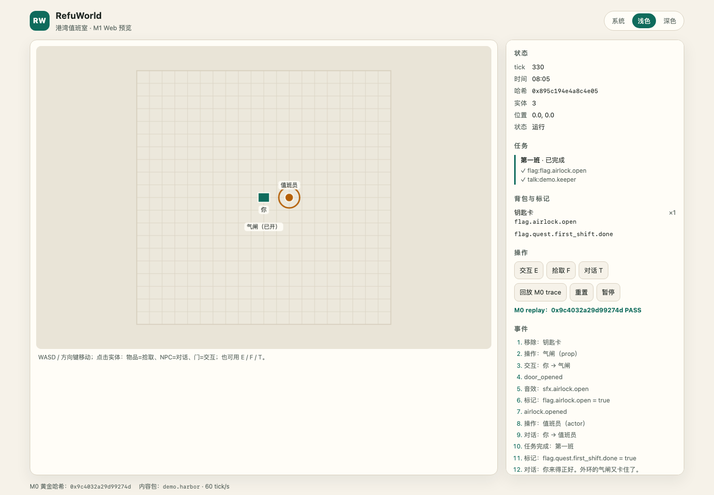
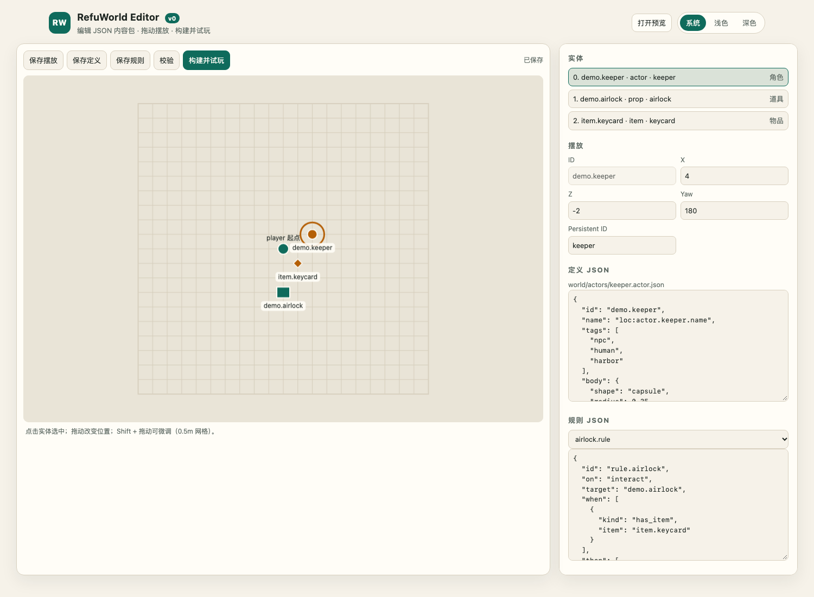

# 07 · M1 切片实现与验收（TS DSL + Web 预览 + 编辑器/移动）

> **一句话**：M1 的核心闭环已经打通——TypeScript DSL 编译出的内容包与 JSON 包**同哈希**；
> Web 预览能移动、交互、完成任务并回放同一 `0x9c4032a29d99274d`；Web 编辑器能拖动摆放、改数据/规则并构建试玩。

> **范围说明**：这是 **M1 主要切片**（TS DSL / Web 预览 / 编辑器 v0 / 移动碰撞 / 内容测试）。
> 5k 真实玩法基准、导航烘焙、QuickJS `ScriptHost` 仍未完成，见 §七。

## 一、结果

| 项 | 结果 |
| --- | --- |
| TS DSL 编译 | `src/content/demo.harbor/*.ts` → 规范化内容包 |
| 与 JSON 包一致 | 包哈希同为 `sha256:52116a11…4ad55f` |
| TS 包跑 M0 trace | `0x9c4032a29d99274d`，与 JSON 包一致 |
| wasm 预览逻辑 | Node 中 replay 与 600 tick 点击序列均 = `0x9c4032a29d99274d` |
| 浏览器实测 | 拾取 → 交互 → 对话，任务完成；回放 `PASS` |
| 移动/碰撞 | 玩家前进被关闭的气闸挡住（z=5.40）；开门后可通过 |
| 编辑器 v0 | 拖动摆放、字段编辑、定义/规则 JSON、校验、构建并试玩 |
| 内容测试 | `first_shift` / `airlock_locked_without_key` 两条 PASS |
| 5k 合成基准 | Apple M1 Pro release：5,000 实体 × 6,000 tick ≈ **0.009 ms/tick**（仅 tick/日程/哈希） |
| 主题 | `system/light/dark` 三态、`aria-pressed`、`lrds-theme` 持久化均实测 |
| 一键验收 | [`test/run_m1.sh`](../test/run_m1.sh) |

## 二、截图

浅色（任务已完成，回放 PASS）：



深色：


编辑器 v0：



## 三、TS DSL

### 3.1 作者写什么

```ts
// src/content/demo.harbor/rules.ts
import { defineRule } from "#world-authoring";

defineRule({
  id: "rule.airlock",
  on: "interact",
  target: "demo.airlock",
  when: [{ kind: "has_item", item: "item.keycard" }],
  then: [
    { kind: "open_door" },
    { kind: "play_sound", id: "sfx.airlock.open" },
    { kind: "set_flag", flag: "flag.airlock.open", value: true },
    { kind: "emit", event: "airlock.opened" },
  ],
  else: [{ kind: "toast", text: "loc:airlock.locked" }],
});
```

- 作者只写 `defineActor` / `defineProp` / `defineItem` / `defineZone` / `defineRule` / `defineQuest` /
  `defineDialogue` / `defineSchedule` / `definePack` / `defineWorld` / `defineLoc`。
- 类型定义在 [`packages/world-authoring/src/types.ts`](../packages/world-authoring/src/types.ts)。
- `#world-authoring` 由 [`package.json`](../package.json) 的 `imports` 映射到本地 TS 包，不需要 `node_modules`。

### 3.2 编译

```bash
cd games/world
node tools/ts-build.mjs --src src/content/demo.harbor --out dist/ts/demo.harbor
# 或
./worldc ts-build --compare data/demo.harbor
```

编译产物与 JSON 包结构完全相同：`pack.json`、`world/*.json`、`world/{zones,actors,props,items}/`、
`rules/`、`quests/`、`dialogue/`、`schedules/`、`loc/`。

### 3.3 实现方式与边界

- Node 24 直接执行带类型标注的 `.ts`（type stripping）；**不做类型检查**。
  类型错误由编辑器/未来的 `tsc --noEmit` 任务发现；编译期只保证结构能被 `worldc validate` 接受。
- 编译器是一个小脚本 [`tools/ts-build.mjs`](../tools/ts-build.mjs)：注册表收集 → 检查必需定义/重复 ID →
  写规范化 JSON → 由 Rust `worldc` 校验/哈希。
- 没有 source map、没有增量编译；M1 编辑器阶段再补。

## 四、Web 预览

```bash
cd games/world
./web/build.sh
cd web
python3 -m http.server 8787
# http://127.0.0.1:8787/
```

### 4.1 架构

```text
data/demo.harbor → worldc build → dist/demo.harbor/pack.data
                                         │
world-wasm (wasm-bindgen) ── PreviewWorld ── web/pkg/world_wasm.js
                                         │
web/app.js ── 60 Hz tick / 点击·键盘命令 / Canvas 2D / HUD / 事件日志
```

- [`world-wasm`](../code/crates/world-wasm/src/lib.rs) 把 `World` 包成 JS 对象：
  `tick`、`pause`、`interact`、`talk`、`pickup`、`command`、`state`、`poll_events`、`replay`、`reset`。
- `state()` 返回只读快照 + 名称/文案/区域边界；`poll_events()` 返回事件 JSON。
- 预览不经过 C ABI（它直接链接 `world-core`），因为它是作者工具，不是引擎适配器；
  引擎适配器仍走 C ABI。这条边界要在 M1 编辑器阶段继续保持。

### 4.2 操作

| 操作 | 方式 |
| --- | --- |
| 移动 | `WASD` / 方向键；圆形玩家 vs 圆形/AABB 障碍 |
| 拾取 | 点击黄色菱形 / `F` |
| 对话 | 点击绿色圆点 / `T` |
| 交互 | 点击橙色方块 / `E` |
| 暂停 / 重置 | `P` / `R` |
| 回放 M0 trace | 按钮；显示 `PASS/FAIL` 与哈希 |

> 移动是 60 Hz 运动学：`speed / tick_hz` 每 tick 位移，先 X 后 Z 分轴解析碰撞；关闭的门与 NPC 会挡路，打开的门不挡。
> 没有跳跃、重力、斜坡或引擎物理；目标仍在 8 米内可交互。

### 4.3 主题

按 [R-016](../../../design/rules/R-016-html-theme-modes.md)：

- 默认 `system`；`localStorage['lrds-theme']` 持久化；
- CSS 加载前内联预绘制；
- 三态按钮可键盘访问，当前项 `aria-pressed="true"`；
- 系统态监听 `prefers-color-scheme`；
- 打印强制浅色；
- 无 JS 时内容可读，主题控件隐藏（不显示假控件）。

### 4.4 编辑器 v0

```bash
cd games/world
./worldc editor --port 8788
# http://127.0.0.1:8788/
```

- 编辑对象是 `data/demo.harbor` 的 **JSON 包**（TS 源不会自动同步；两种前端各自编译到同一规范包）。
- 布局：Canvas 中拖动 placement，0.5m 网格（Shift 0.1m），实时写回 `at`。
- 数据：选中实体后编辑 X/Z/Yaw/Persistent ID，右侧显示并保存对应 actor/prop/item JSON。
- 规则：选择 `rules/*.json`，直接编辑 JSON 并保存。
- 校验：调用 `worldc validate`，把错误码/路径/信息回显；每次保存先写后校验，失败自动回滚（HTTP 422）。
- 构建并试玩：保存当前编辑 → `worldc build` → 复制 `pack.data` 到 `web/` → 打开 `/index.html`。
- 预览页面每 1.5s 轮询 `/api/pack-version`；编辑器构建后自动刷新（热重载的最小实现）。

> v0 是「原始 JSON + 摆放拖拽」，不是完整 schema 表单/对话图；见 §七。服务器只绑定 `127.0.0.1`，无鉴权，供本机开发。

## 五、验收证据

### 5.1 命令行

```text
ts-build: pack_hash: sha256:52116a114d4d9968ecaaee6fa8d1338c3a248f7fb92de7b4d00b34b5184ad55f
compare: PASS（与 data/demo.harbor 一致）
test: demo.harbor ticks=600 hash=0x9c4032a29d99274d
content-test: first_shift PASS
content-test: airlock_locked_without_key PASS
editor smoke PASS
wasm preview: replay=0x9c4032a29d99274d preview=0x9c4032a29d99274d movement z=5.40
```

### 5.2 浏览器（Chrome headless + CDP）

- 初始渲染：tick、时间、哈希、实体数、任务、事件均可见；
- 点击「拾取 F」→「交互 E」→「对话 T」后，任务显示「第一班 · 已完成」，
  目标 `flag:flag.airlock.open` 与 `talk:demo.keeper` 都打勾；
- 背包显示「钥匙卡 ×1」；
- 「回放 M0 trace」显示 `0x9c4032a29d99274d PASS`；
- 主题按钮 `dark/light/system` 分别得到 `data-theme=dark/light/light`、`data-theme-choice` 当前项正确、
  `aria-pressed=true`，`localStorage['lrds-theme']` 最终为 `system`。
- 编辑器：`GET /api/pack` 加载 13 个文件；`PUT /api/file` 改 placement；非法引用返回 422 并回滚；`POST /api/validate` 0 错；`POST /api/build` 成功。

## 六、文件

| 路径 | 作用 |
| --- | --- |
| [`package.json`](../package.json) | `#world-authoring` import map |
| [`packages/world-authoring/`](../packages/world-authoring/) | 类型化 DSL 与注册表 |
| [`src/content/demo.harbor/`](../src/content/demo.harbor/) | TS 版「港湾值班室」 |
| [`tools/ts-build.mjs`](../tools/ts-build.mjs) | TS → 规范化内容包编译器（含 sourcemap） |
| [`tools/editor-server.mjs`](../tools/editor-server.mjs) | 本地编辑器服务器（读/写/校验/构建） |
| [`code/crates/world-wasm/`](../code/crates/world-wasm/) | wasm 预览门面 |
| [`web/`](../web/) | 预览 + 编辑器页面、构建脚本、Node 测试 |
| [`data/demo.harbor/tests/`](../data/demo.harbor/tests/) | 内容测试与 M0 trace |
| [`test/run_m1.sh`](../test/run_m1.sh) | M1 一键验收 |
| [`test/editor_smoke.mjs`](../test/editor_smoke.mjs) | 编辑器服务器保存/校验/构建冒烟 |

## 七、已知限制 / 剩余 M1

1. **编辑器不是完整 schema 表单**：数据/规则是原始 JSON 文本；没有生成式表单、对话图、撤销/重做。
2. **编辑器只编辑 JSON 包**：`src/content/demo.harbor` 的 TS 源不会自动同步；两套前端需要各自维护。
3. **TS 编译器不做类型检查**：Node 只剥离类型；sourcemap 已生成，但 `tsc --noEmit` 仍未接。
4. **热重载只覆盖「编辑器构建 → 预览刷新」**：改 TS 源仍需手动 `ts-build`；没有文件监听/增量编译。
5. **移动是最小运动学**：没有跳跃/重力/斜坡/导航；NPC 不移动，只有日程行为状态。
6. **5k 只有合成基线**：`worldc bench --synthetic 5000` 约 0.009 ms/tick（M1 Pro），不含真实查询/战斗/组件变更。
7. **没有导航/资产管线**：`world_zone_assets` 仍返回 `[]`。
8. **QuickJS 未接入规则**：仍是 Rust 解释 JSON 规则。
9. **wasm-bindgen 版本锁定**：crate 固定 `=0.2.129` 以匹配本机 CLI；升级要同时升级 CLI。
10. **web 生成物不入库**：`web/pkg`、`web/node-pkg`、`pack.data`、`m0.trace.json` 由 `web/build.sh` 生成。
11. **CI 未覆盖 wasm-bindgen/编辑器冒烟**：CI 目前跑 cargo test/C ABI/wasm core/TS 编译器/R-016；
    `wasm-bindgen` 与编辑器服务器需要额外工具/端口，加入 CI 要额外步骤（后续补）。

## 八、下一步

按价值排序：

1. **编辑器 v0.5**：从原始 JSON 升级到 schema 表单、对话图、撤销/重做。
2. **TS 类型检查 / 增量热重载**：`tsc --noEmit`、文件监听、sourcemap 到内容错误。
3. **5k 实体基准** + `bevy_ecs` 复核。
4. **导航烘焙与资产依赖**：`worldc bake nav`、`world_zone_assets`。
5. **ScriptHost 接入 QuickJS**：事件/命令/查询/预算。
