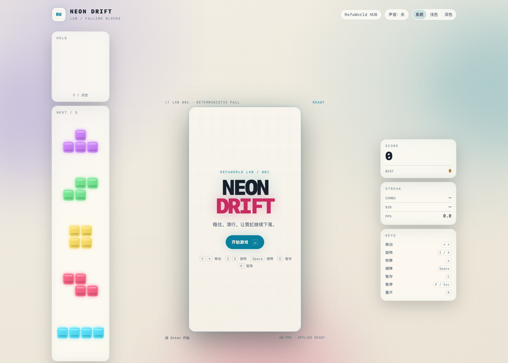
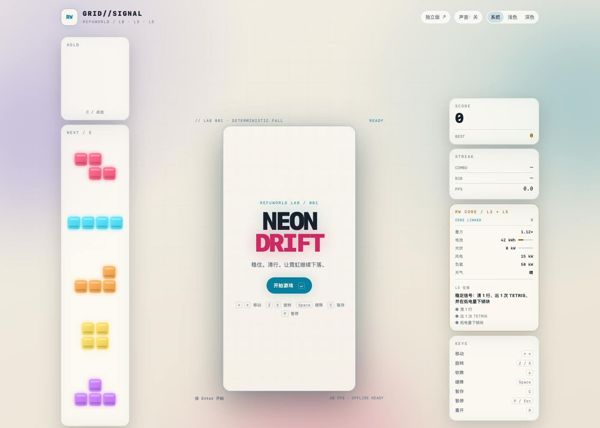

# NEON DRIFT · 方块坠落




一个可直接发布的落块游戏（Tetris-like）。纯静态、无构建、无外部依赖；Canvas 2D + WebAudio 合成音效 + PWA 离线缓存。

> **命名与权利**：代码、视觉与音效为本项目原创。玩法属于落块品类；不包含 Tetris Company 的官方素材、商标或音乐。正式商业发行前请自行做商标/外观权利审查。

## 玩法

- 标准 10×20 棋盘，7-bag 随机袋
- SRS 旋转与踢墙（JLSTZ / I）
- Hold（暂存）、5 个 Next、Ghost（幽灵块）
- Lock Delay 500ms / 最多 15 次重置
- T-Spin 三格角检测
- 消行：Single / Double / Triple / Tetris
- Combo、B2B、Perfect Clear、等级与重力加速
- 软降 1 分/格、硬降 2 分/格
- 最高分本地保存

## 操作

| 操作 | 键盘 | 触屏 |
| --- | --- | --- |
| 左右移动 | `←` / `→` | `←` / `→` |
| 软降 | `↓` | `↓` |
| 顺时针旋转 | `X` / `↑` | `⟳` |
| 逆时针旋转 | `Z` | — |
| 硬降 | `Space` | `DROP` |
| 暂存 | `C` | `H` |
| 暂停 | `P` / `Esc` | — |
| 重开 | `R` | — |

DAS 150ms，ARR 35ms；软降重复 45ms。移动端按钮支持按住连发。

## 两个入口

| 入口 | 依赖 | 说明 |
| --- | --- | --- |
| [`index.html`](index.html) | 无 | 独立版；纯静态，可单独发布 |
| [`refuworld.html`](refuworld.html) | RefuWorld wasm | 同玩法，但接入 L0 固定 tick、L3 任务、L5 能源系统 |



RefuWorld 版复用同一套 `logic.mjs` / `game.mjs` / UI，通过 `refuworld-bridge.mjs` 把会话接到内核：

- **L0**：60Hz tick / 时间推进
- **L3**：`quest.tetris.grid`；清 1 行、Tetris、低电量锁块三个目标
- **L5**：光伏/风电/电池/负载/天气；低电量时重力倍率上升

它**不**接入 L1 主体交互、L2 行为、L4 社会关系；落块玩法与这些层没有自然依赖，不硬塞。

### RefuWorld 版发布

`refuworld.html` 不是单文件独立版，需要把以下内容一起部署：

```text
lab/tetris/refuworld.html
lab/tetris/refuworld.css
lab/tetris/refuworld-bridge.mjs
lab/tetris/refuworld.pack.data
lab/tetris/game.mjs / logic.mjs / audio.mjs / style.css
web/pkg/world_wasm.js + .wasm
web/vendor/quickjs-env.js
```

用仓库根服务即可：

```bash
cd games/world
node tools/serve-web.mjs --port 8787
# http://127.0.0.1:8787/lab/tetris/refuworld.html
```

重新生成 pack：

```bash
cd games/world
./lab/tetris/build-refuworld.sh
```

## 本地运行

```bash
cd games/world
node tools/serve-web.mjs --port 8787
# http://127.0.0.1:8787/lab/tetris/
```

不能直接双击 `index.html`：ES modules 和 Service Worker 需要 HTTP(S)。
部署：把 `lab/tetris/` 整个目录放到任意静态站点根路径即可；需保证 `.mjs` 以 `text/javascript` 返回。

## 测试

```bash
node lab/tetris/test/logic.test.mjs
node lab/tetris/test/static.test.mjs
node lab/tetris/test/refuworld.test.mjs
```

覆盖：

- 7-bag 每 7 个包含全部 7 种方块
- 种子 RNG 可复现
- 预览队列长度 / 棋盘尺寸
- 消行与棋盘高度
- 硬降与计分
- Hold 一次限制
- 暂停状态机
- 重力下落
- T-Spin 三角检测
- 顶出结束

## 结构

```text
tetris/
├── index.html          # 语义结构 + R-016 三态主题预绘制
├── style.css           # 霓虹视觉 / 响应式 / 触屏 / reduced motion
├── logic.mjs           # 纯逻辑，无 DOM / 无计时器 / 可单测
├── audio.mjs            # WebAudio 合成 SFX，无音频文件
├── game.mjs            # Canvas 渲染、输入、UI、PWA 注册
├── manifest.webmanifest
├── icon.svg / icon-192.png / icon-512.png
├── sw.js               # 离线 shell
└── test/logic.test.mjs
```

### 设计取舍

- **逻辑与渲染分离**：`logic.mjs` 不知道 Canvas、DOM、Audio，测试可直接 import。
- **确定性**：所有随机来自显式 `Rng` 种子；种子显示在页脚，便于复现。
- **输入与时间分离**：逻辑接受 `dt`，UI 负责 60fps/键盘重复；暂停不推进世界。
- **无素材**：音效由振荡器合成，视觉由 Canvas 绘制；不需要网络。
- **可访问性**：按钮有 `aria-label`，状态有 `aria-live`，支持 reduced motion；键盘可完全操作。

## 兼容性

- 现代 Chrome/Safari/Firefox/Edge，需 ES modules、Canvas 2D、WebAudio。
- PWA 安装需要 HTTPS（localhost 例外）。
- 没有排行榜服务；最高分只存在本机 `localStorage`。

## 已知边界

- 没有在线对战/排行榜/账号。
- 没有 SRS 180° 旋转；T-Spin 使用简化三格角判定。
- 音效是合成音，不是音乐；没有音量滑杆。
- 这是 Lab 游戏，不依赖 RefuWorld 内核，也不承诺跨宿主同一状态。
