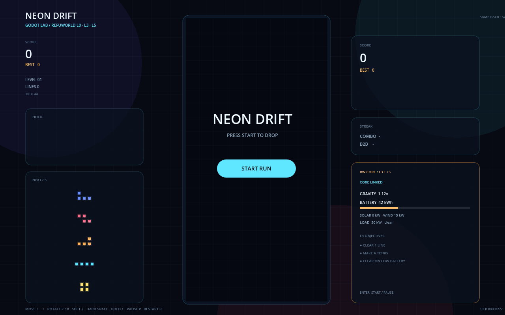

# NEON DRIFT · Godot adapter

同一款落块游戏的 **Godot 4.7 版本**。共享同一套 RefuWorld 内核和 `data/lab.tetris` 内容包；玩法、棋盘、Hold/Next、SRS、T-Spin、Combo/B2B 与 Web RefuWorld 版一致。



## 依赖层次

- **L0**：固定 60Hz tick / 时间推进
- **L3**：`quest.tetris.grid` 公共任务；消行发送 `set_flag`
- **L5**：光伏、风电、电池、负载、天气；低电量提高重力

不依赖 L1/L2/L4；落块玩法没有自然的交互/日程/社会关系依赖。

## 运行

要求：

- Godot 4.7
- Rust toolchain
- 仓库里的 `worldc` / `godot-extension`

```bash
cd games/world
./lab/tetris/godot/build.sh
godot --path lab/tetris/godot
```

构建脚本会：

1. 编译 `world_godot` GDExtension 到 `bin/`
2. 用 `data/lab.tetris` 生成 `refuworld.pack.data`
3. 写 Godot 扩展清单

Godot 窗口默认 1280×800；键盘操作：

```text
← → 移动   Z / X 旋转   ↓ 软降   Space 硬降
C 暂存     P / Esc 暂停   R 重开   Enter 开始
```

## 测试

```bash
cd games/world
./lab/tetris/godot/test.sh
```

测试覆盖：

- 7-bag 队列
- hard drop / 棋盘占位
- 消行
- T-Spin 三角检测
- L5 systems 解析
- L3 quests 解析
- GDExtension `load_pack` / `tick` / `command_json set_flag` / flags

## 结构

```text
godot/
├── project.godot
├── main.tscn / main.gd        # Control UI、输入、L0/L3/L5 面板
├── tetris_logic.gd            # 纯逻辑，和 Web 版同规则
├── world_godot.gdextension
├── build.sh / test.sh
├── test.tscn / test.gd
├── refuworld.pack.data         # 构建产物（不提交）
└── bin/                        # 平台 GDExtension（不提交）
```

## 与 Web 版的差异

- Godot 使用原生 `Control` 绘制，不是 Canvas 2D；视觉采用同一套霓虹色板与三栏布局，但不是像素级一致。
- 目前没有内置音效、触屏按钮和主题三态；桌面键盘是主路径。
- 退出/暂停不会写存档；每次 `START` 重新加载同一份 pack。

## 独立发布

Godot 版整个目录可单独导出；发布时需同时带：

- `bin/` 下当前平台的 GDExtension
- `refuworld.pack.data`
- Godot 导出模板

`build.sh` 只负责开发运行；真正发布用 Godot 的 Export Preset。
