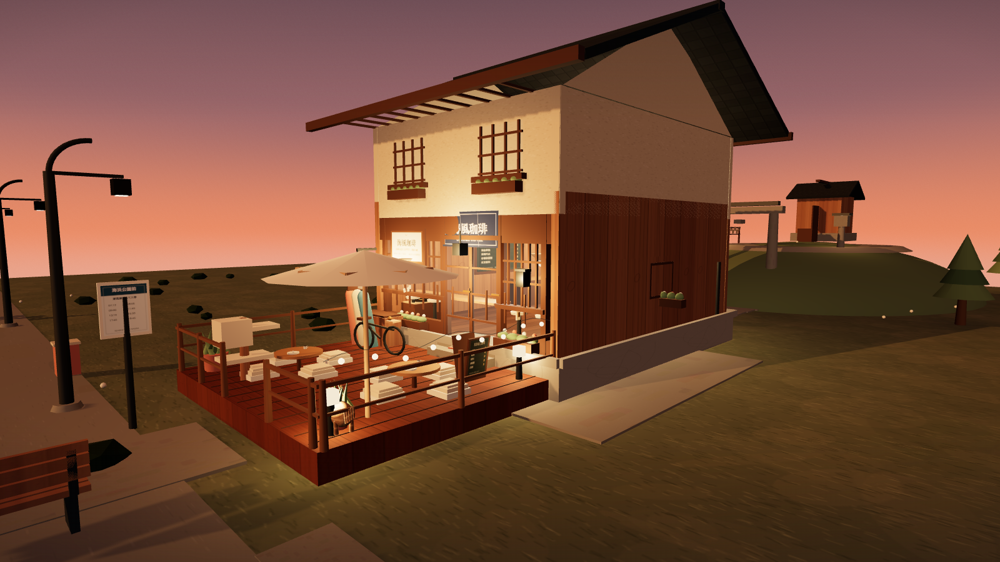

# 海風珈琲・潮音の庭

> 日式海边咖啡馆的第一人称可探索场景。低多边面 + 程序化 Canvas 纹理 + 自定义海面 / 天空 shader + WebAudio，全部资产现场生成，不依赖外部模型、图片或音频。



## 0. 快速进入

```bash
cd lab/seaside-cafe
./run.sh              # 默认 http://127.0.0.1:8036/
# 或
node ../../tools/serve-static.mjs --root . --port 8036 --bind 127.0.0.1
```

打开 `index.html` 后点击「进入咖啡馆」。首次点击会启用 WebAudio 并请求指针锁定；若浏览器拒绝锁定，按住画面拖动也能环视。

- **桌面**：WASD 移动，Shift 加速，鼠标环视，E / 点击交互，P 拍照，1–4 拍照滤镜，ESC 起身 / 释放鼠标。
- **移动端**：左下摇杆移动，右侧拖动环视，右下按钮交互。
- **时间/天气**：右上角 ☼ 打开面板，拖动时间滑块或点清晨/正午/黄昏/夜晚，切换晴天/雨天。
- **画质**：天气面板底部「画质」开关；低画质关闭实时阴影、降低像素比。
- **调试截图**：`?shot=hero|terrace|interior|window|sea|beach|shrine|port|night|rain|start`，可叠加 `&hud=1`；`?t=0..1`、`?weather=rain`、`?selftest=1`。

## A. 场景设计文档

### A.1 概念

海风从西侧来，穿过沙滩、石板步道，推开玻璃门，把靛蓝暖帘吹得轻轻摆动。空间是「町屋木结构 + 现代玻璃 + 手作咖啡」：深灰瓦、杉木竖板、白灰泥、原木吧台、黄铜、靛蓝布、陶器、玻璃汽水瓶。玩家在黄昏进入，室内 2700K 暖光与窗外海光形成冷暖对比；也可以把时间推到清晨、正午、夜晚或雨天。

设计关键词：**安静、可坐、可碰、可听、可看海**。
玩法基调：没有失败条件。菜单点单、等一杯 8 秒的手冲、找座位、喝一口、收集 5 枚贝壳、在神社写一块绘马，都是「把今天过慢一点」的轻任务。

### A.2 空间布局（文字版）

```
             北（-z）
        ┌──────────────┐
        │   小渔港/栈桥  │
        │   -42..-28   │
        └──────────────┘
  西（-x）                                      东（+x）
  海 x<-95..-36 │ 沙滩 -36..-18 │ 步道 -18..-10 │ 咖啡馆 -4..4 │ 神社 11..29
                │ 潮池/礁石     │ 路灯/长椅      │ 露台 -9..-4  │ 小丘/鸟居/绘马
                │ 灯塔 -80,-30  │                │ 原点          │
                └──────────────┘
             南（+z）公交站 5.5,14 / 售货机 10,13 / 冲浪店 18,20
```

提示词中的「海面 z=-35..-70」与「咖啡馆在原点、向东神社」存在轴向冲突；本项目统一采用 **海在西侧（-x）**，把原提示的 z 数值平移到 x 轴。为了第一人称能看到海，沙滩压缩为 **18m**（-36..-18，仍在提示 18–45m 范围内），海从 **x=-36** 开始（距咖啡馆 36m，落在提示 35–70m 范围内）。

### A.3 坐标与动线

| 区域 | 范围（x / z） | 高度 | 说明 |
| --- | --- | --- | --- |
| 咖啡馆 | -4..4 / -3..3 | 室内 0.80m | 8×6m，两层，一层营业 |
| 露台 | -9..-4 / -3..3 | 0.45m | 木地板、栏杆、两桌四垫 |
| 石板前庭 | -10..8 / -4..8 | 约 0.04m | 连接咖啡馆、步道、神社小径 |
| 海滨步道 | -18..-10 / -35..25 | 0.05m | 石板、路灯、长椅、站牌 |
| 沙滩 | -36..-18 / -40..28 | -0.33..0.05m | 缓坡、潮池、礁石、木栈道 |
| 海面 | -95..-36 / -51..39 | -0.34m + 潮汐 | 自定义 shader，逐帧波浪 |
| 神社小丘 | 11..29 / -9..11 | 0..2.65m | 石鸟居、石灯笼、小祠、绘马 |
| 渔港 | -42..-28 / -38..-28 | 0.22m | 木栈台、渔船、浮标、木箱 |
| 公交/售货 | 4..11 / 12..16 | 0.05m | 候车亭、站牌、售货机 |
| 冲浪店/停车 | 12..24 / 17..24 | 0.05m | 低模店、冲浪板、车位、淋浴 |

**动线**：海 / 沙滩 → 木栈道 → 步道 → 露台 → 玻璃门 → 室内吧台 → 窗边座位 / 榻榻米 → 东侧神社；另一条支线沿步道向北到渔港，向南到公交站、售货机和冲浪店。

### A.4 视觉焦点与色彩

| 色 | 值 | 用途 |
| --- | --- | --- |
| 杉木原木 | `#a87852` / `#8e5e40` | 外墙、露台、吧台 |
| 深灰瓦 | `#3a3f43` | 屋顶；黄昏时保留冷灰 |
| 白灰泥 | `#e6ddcb` / `#f0e9da` | 二层墙面、山墙 |
| 靛蓝 | `#26334d` | 暖帘、坐垫、玻璃门框 |
| 黄铜 | `#b58a4f` | 风铃、门把、灯具 |
| 海盐青 | `#5d9aa1` / `#1e4552` | 海面、潮池、玻璃 |
| 珊瑚 | `#c47a65` | 冲浪板、坐垫、邮筒、救生塔 |
| 暖灯 | `#ffc47d` / `#ffb36b` | 室内 2700K、串灯、灯塔 |

**视觉焦点**：① 正门—暖帘—旧木招牌；② 露台遮阳伞与串灯；③ 室内 L 形吧台 + 黑板菜单；④ 窗边长桌看海；⑤ 海面灯塔与落日；⑥ 神社小丘。

### A.5 时间 / 天气 / 潮汐

- 时间：`state.time` 0..1 映射到 24h 的展示时间（5:00 起算），太阳方位、天空三段色、雾、海面反照率、室内外灯比、灯塔光束、星星/月亮都随之变化。
- 天气：晴天 / 雨天。雨天降低太阳强度、增加雾密度、启用 Points 雨线和全屏 CSS 雨丝、提高海浪与风声；风铃摆幅增大。
- 潮汐：`state.tide` 每 0.5s 缓慢更新，海面高度 ±5cm，潮池水位和透明度跟随；UI 显示涨潮/退潮。
- 预设时间点：清晨 `.12`、正午 `.30`、黄昏 `.70`、夜晚 `.92`。

## B. 资产与元素清单表

> 全部由 `THREE.BoxGeometry` / `CylinderGeometry` / `SphereGeometry` / `ShapeGeometry` / `BufferGeometry` / `InstancedMesh` + Canvas 纹理程序化生成；无 GLTF、图片、音频文件。

### B.1 建筑与室外

| # | 名称 | 类型 / 尺寸 | 材质 / 颜色 | 位置 | 交互 / 动画 / 音效 |
| --- | --- | --- | --- | --- | --- |
| 1 | 建筑基座 | 8.5×0.76×6.5m | 混凝土灰 | 0,0.38,0 | 承托；室内地坪 0.8m |
| 2 | 一层杉木墙 | 8×3.65×6m 体量 | 程序化木纹 `#a87852` | 原点 | 竖向木纹；局部白灰泥 |
| 3 | 二层白灰泥 | 8×2.35×6m | 白灰泥 `#e6ddcb` | y 3.6..6.0 | 山墙三角 |
| 4 | 双坡屋顶 | 5.35×0.16×8.7m×2 | 深灰瓦 Canvas | 脊高 8.25m，檐口 6.0m | 约 24–25°，檐出 1.2m |
| 5 | 玻璃推拉门 | 1.8×2.2m | 木框 + 透明玻璃 | x=-4,z=0.6 | E 开合、碰撞同步、木门声 |
| 6 | 靛蓝暖帘 | 1.8×0.78m | 靛蓝布 + 白字 | 门楣 | 顶点波动；可点击风铃 |
| 7 | 旧木招牌 | 1.3×0.78m | 白漆木、锈钩 | 门左侧 | 自发光微亮；可读 |
| 8 | 侧挂招牌 | 0.48×0.68m | 木框 + 「珈琲」 | 门右上方 | 自发光微亮 |
| 9 | 木格窗 | 1.95m 高 ×2 段 | 木格 6×4 + 雾面玻璃 | 正立面 | 室内可见；反射弱 |
| 10 | 二层窗 + 花箱 | 1.25×1.05m | 玻璃、木格、珊瑚/白花 | 正立面 y≈4.95 | 暖帘/窗帘；花箱 |
| 11 | 黄铜风铃 | 0.32×0.7m | 黄铜 + 玻璃管 + 短册 | 檐下 -4.65,2.62,-1.0 | E 摆动、清脆振荡器声 |
| 12 | 壁灯 ×2 | 0.2×0.3m | 黑金属 + 暖光 | 门左右 | 点光源、黄昏亮 |
| 13 | 露台 | 5×0.45×6m | 木板 + 5mm 缝 | -6.5,0.225,0 | 高 0.45m；木纹 |
| 14 | 木栏杆 | 高 0.9m | 深木 | 露台三边 | 留出下沙滩开口 |
| 15 | 矮桌 ×2 | 0.96m 直径×0.36m | 橡木/旧木 | -7.25,-1.15 / -6.35,1.55 | 贝壳盘、菜单卡、水杯 |
| 16 | 坐垫 ×8 | 0.48×0.12×0.48m | 米白棉布 | 桌周 | 点击坐下；相机过渡 |
| 17 | 遮阳伞 | 半径 1.45m | 米白布 + 木骨 | -7.8,0.45,2.3 | E 开合；缩放动画 |
| 18 | 冲浪板架 | 3 块 1.7m | 珊瑚/米白/海青 | 露台南侧 | 低模；不可交互 |
| 19 | 旧自行车 | 1.6×0.9m | 铁 + 木 | 露台西侧 | 点击车铃「叮铃」 |
| 20 | 藤编鞋柜/拖鞋 | 0.55×0.72×1.3m | 藤/木/珊瑚 | 门北侧 | 生活细节 |
| 21 | 串灯 | 18 颗 | 暖白发光球 | 露台南栏杆 | 黄昏亮；灯串微光 |
| 22 | 猫爬架/水碗 | 1.2m 高 | 木 + 米白布 | 露台西北 | 店猫巡逻点 |
| 23 | A 字菜单牌 | 0.55×0.85m×2 | 黑板 + 木框 | -5.3,0.45,1.95 | E 看菜单/点单 |
| 24 | 海葡萄/迷迭香 | 盆径 0.5m | 陶盆 + 绿植 | 露台两角 | 程序化叶片 |

### B.2 室内

| # | 名称 | 类型 / 尺寸 | 材质 / 颜色 | 位置 | 交互 / 动画 |
| --- | --- | --- | --- | --- | --- |
| 25 | 深色木地板 | 7.8×0.06×5.8m | 深棕木纹 | y=0.79 | 与混凝土基座分离，避免 z-fighting |
| 26 | L 形吧台 | 主 0.72×0.85×2.8m；侧 1.8×0.85×0.62m | 旧木前板 + 橡木台面 | 东侧 | 碰撞；台面工具 |
| 27 | 手冲架/滤杯/分享壶 | 0.5m 高 | 铁、陶、玻璃 | 台面 | 点单动画的一部分 |
| 28 | 手摇磨豆机 | 0.28m | 铁 + 黄铜 | 台面 | 磨豆噪声 |
| 29 | 电子秤 / 铜壶 / 虹吸壶 | 0.2–0.3m | 黑金属/铜/玻璃 | 台面 | 静态细节 |
| 30 | 咖啡豆玻璃罐 ×6 | 0.16m 高 | 玻璃 + 咖啡豆色 | 后吧台 | 6 种豆色 |
| 31 | 玻璃甜点柜 | 0.5×0.55×0.9m | 玻璃 + 木 | 吧台 | 芝士/柠檬/红豆模型 |
| 32 | 黑板菜单 | 2.3×1.3m | 黑板 + 粉笔字 | 北墙 | E 看菜单/点单 |
| 33 | 杯架/瓶架 | 2 层 | 木 + 玻璃/陶 | 东墙 | 内置 12 件 |
| 34 | 书架 | 2.0×1.9m | 深木 + 旧书 | 南墙 | 14 本彩色书脊 |
| 35 | 榻榻米角 | 2.5×1.1m | 草编纹 + 木矮桌 | 东南角 | 4 个坐垫可点击 |
| 36 | 黑胶唱片机 | 1.1×0.6m | 木、黑胶 | 西北角 | E 播放/停止；唱片旋转 |
| 37 | 窗边长桌/高脚凳 | 长 3.4m；4 凳 | 橡木 + 铁 + 米白 | 西窗 | 4 个座位可点击 |
| 38 | 冰箱/水槽/咖啡渣桶 | 1.0×1.9m | 米白金属/铁 | 东侧 | 低模生活细节 |
| 39 | 纸灯笼 | 0.32×0.3m | 和纸 + 暖光 | 榻榻米上方 | 点光源 |
| 40 | 藤编吊灯 ×2 / 轨道灯 ×3 | 0.64m 直径 | 藤/黑金属/暖光 | 天花板 | 暖光；风扇旋转 |
| 41 | 海报/月历/时钟/WiFi 木牌 | 0.7–1.1m | 纸/木 | 三面墙 | Canvas 文字 |
| 42 | 猫窝/食盆 | 0.85×0.18×0.7m | 米白布/陶 | 南侧 | 店猫休息点 |

### B.3 周边与自然

| # | 名称 | 类型 / 尺寸 | 材质 / 颜色 | 位置 | 交互 / 动画 |
| --- | --- | --- | --- | --- | --- |
| 43 | 海面 | 59×90m，70×60 段 | 自定义 Shader：深青/浅青/泡沫/落日金 | x -95..-36 | 顶点波、岸线泡沫、潮汐、反光 |
| 44 | 沙滩 | 18×68m 网格 | 沙色 Canvas + 湿沙带 | -36..-18 | 缓坡、脚印、贝壳、海藻 |
| 45 | 潮池 ×2 | 半径 1.2/1.55m | 青绿水面 + 泡沫环 | -30,-11 / -27,13 | 潮汐水位、石块 |
| 46 | 礁石 / 消波块 | 0.55–1.2m | 深灰石 | 海岸线 | 5 块礁石 + 4 个四脚块 |
| 47 | 灯塔 | 9.8m 高 | 白/红条纹、玻璃灯室 | -80,-30 | 夜间旋转暖光束、点光 |
| 48 | 沙滩木栈道 | 15 块 ×1.1m | 木板 + 木桩 + 绳栏 | z=4.6，-34..-18 | 从步道下到海边 |
| 49 | 救生员塔 | 2.5m 高 | 木 + 珊瑚红 | -26,-8 | 红白旗；可查看文案 |
| 50 | 遮阳伞 / 躺椅 | 2 组 | 米白 + 珊瑚 | 沙滩南侧 | 低模 |
| 51 | 石鸟居 | 3.3×3.7m | 风化石灰 + 青苔 | 13.2,0 | 穿越；石灯笼 |
| 52 | 小祠 | 3.4×3.3m | 木 + 灰瓦 | 23.5,1 | 神社焦点 |
| 53 | 绘马架 / 许愿箱 | 2.0m 宽 | 木 + 绘马 | 21.5,-3.4 / 20.2,1 | E 许愿，生成手写绘马 |
| 54 | 渔港栈台 | 13×9m | 木 + 木桩 | -35,-32 | 渔船 ×2、渔网、浮标 |
| 55 | 公交候车亭/站牌 | 3.6×2.6m | 木 + 布告 | 5.5,14 | 可读到站时间 |
| 56 | 自动售货机 | 1.2×2.0m | 青蓝 + 发光面板 | 10.2,13.3 | E 购买，掉落汽水罐 |
| 57 | 冲浪店/停车位 | 8×3×5.2m | 米白木、低模冲浪板 | 18,20.5 | 3 个车位、4 个店招 |
| 58 | 步道家具 | 4 盏路灯、3 张长椅、垃圾桶、邮筒 | 铁/木/珊瑚 | -10.8..-12.2 | 路灯点光；长椅可坐 |
| 59 | 树/灌木/野花/沙丘草 | 6 棵松 + 40 丛灌木 + InstancedMesh | 低饱和绿 | 全场 | 3 个 InstancedMesh |
| 60 | 海鸥 | 1 只盘旋 + 1 只停地 | 白/灰 | 空中 / 步道 | E 惊飞；翅膀动画 |
| 61 | 天空 | 半径 250m 球 | 自定义 Shader：三段色 + 太阳 + 星 | 全场景 | 随时间变化 |
| 62 | 雨 | 1200 Points + CSS 雨丝 | 冷白/青 | 相机周围 | 雨天显示 |
| 63 | 店猫「小潮」 | 0.45m 高 | 程序化虎斑 Canvas | 露台/室内 | 抚摸、呼噜、爱心、巡逻 |

## C. 交互清单表

| # | 对象 | 触发 | 条件 / 距离 | 反馈动画 | 音效 | UI / 文案 | 冷却 |
| --- | --- | --- | --- | --- | --- | --- | --- |
| 1 | 玻璃门 | E / 点击 | 3m | 两扇门沿 z 滑开，碰撞体同步 | 低频木门声 | 「门开了，海风进来了一点。」 | 0.4s |
| 2 | 风铃 | E / 点击 | 3.2m | 三根玻璃管摆动 | 3 个正弦泛音 | 「风铃响了一声，很轻。」 | 1s |
| 3 | 黑板菜单 / A 字牌 / 菜单立牌 | E / 点击 | 3.4m | 弹出菜单 modal | UI 点击 | 手冲 / 拿铁 / 汽水 / 蛋糕 | 无 |
| 4 | 点单 | 菜单按钮 | 菜单打开 | 8 秒：磨豆→注水→蒸汽；完成后相机手持杯出现 | 磨豆、注水、蒸汽、铃声 | 「正在制作…」→「去窗边坐下吧」 | 8s |
| 5 | 咖啡杯 / 喝咖啡 | 座位中 E | 已点单 + 已坐下 | 画面短暂暖色、杯子消失 | 蒸汽/轻响 | 「咖啡很暖，海风刚好。」 | 1s |
| 6 | 窗边 / 露台 / 榻榻米 / 长椅 | E / 点击 | 2.2–2.4m | 相机 lerp 到坐姿，ESC 起身 | 轻 UI | 「按 E 喝咖啡 / ESC 起身」 | 1s |
| 7 | 唱片机 | E / 点击 | 2.8m | 唱片旋转；和弦垫 + 旋律 | 程序化 WebAudio | 「唱片开始转。」 | 0.5s |
| 8 | 灯开关 | E / 点击 | 2.4m | 室内外暖灯开/关，灯泡亮度变化 | 轻响 | 「灯亮了 / 灯关了」 | 0.4s |
| 9 | 时间滑块 / 清晨正午黄昏夜晚 | UI | 任意 | 太阳、天空、雾、海色、灯、星、月亮 | 无 | 顶部时间标签 | 无 |
| 10 | 天气按钮 / 晴天雨天 | UI | 任意 | 雨线、雨丝、风浪、太阳强度 | 雨声/风声 | 「雨 · 潮声渐密」 | 无 |
| 11 | 店猫「小潮」 | E / 点击 | 3.2m | 呼噜、爱心粒子、暂停巡逻 | 猫叫 + 呼噜 | 「小潮发出呼噜声。」 | 2.5s |
| 12 | 贝壳 ×5 | E / 点击 | 3m | 贝壳消失、进度 +1 | 高频轻响 | 「拾起一枚贝壳（n/5）」 | 无 |
| 13 | 神社许愿箱 / 绘马架 | E / 点击 | 2.6m | 输入短句 → 生成手写绘马挂上 | 四音铃 | 「绘马挂上去了。」 | 无 |
| 14 | 自动售货机 | E / 点击 | 2.9m | 罐子掉落到取物口 | 机械声 + 落罐 | 「哐当。一瓶冰汽水…」 | 1.6s |
| 15 | 自行车铃 | E / 点击 | 2.6m | 车把轻晃 | 双音车铃 | 「叮铃。」 | 1s |
| 16 | 遮阳伞 | E / 点击 | 3.2m | 伞面缩放开/合 | 布料/轻响 | 「遮阳伞撑开/收起」 | 0.8s |
| 17 | 海鸥 | E / 点击 | 3.2m | 地面海鸥飞起消失 | 翅膀/鸣叫 | 「海鸥拍拍翅膀…」 | 一次 |
| 18 | 拍照模式 | P / 按钮 | 全局 | 隐藏 HUD，自由视角，滤镜 | 快门轻响 | 拍照栏 1–4 滤镜 | 无 |
| 19 | 渔港 / 救生塔 / 站牌 | 点击查看 | 3.2m | 文案反馈 | 无 | 环境叙述 | 无 |

所有交互统一由 `registerInteract(name, object, label, action, {max, dynamic})` 注册；命中盒放在 **layer 1**，相机 layer 0 不渲染，Raycaster 单独开启 layer 1。悬停时用 `Box3Helper` 描边 + 准星变化；点击 / E 执行；每个交互有 `cooldown`。

## D. 技术架构

### D.1 运行链

```
src/head.html   UI + CSS + importmap（unpkg three@0.187.0）
src/10-core.js  renderer / scene / camera / state / 工具 / 碰撞 / 交互注册
src/20-textures.js Canvas 纹理 + 材质表
src/30-audio.js WebAudio 程序化音频
src/40-world.js 天空 / 光 / 地形 / 海 / 海岸 / 灯塔 / 神社 / 渔港 / 南侧 / 海鸥 / 贝壳 / 雨 / 时间天气
src/50-cafe.js  咖啡馆建筑 / 露台 / 室内 / 猫 / 咖啡杯 / 局部合并
src/60-interactions.js 射线交互 / UI / 点单 / 许愿 / 拍照 / 移动端
src/70-main.js  组装 / 第一人称控制 / 相机 / 循环 / 截图视角 / 静态合批
src/foot.html   错误兜底 + 收尾
        ↓ python3 build.py
index.html  单文件（约 19 万字符，约 3.9k 行）
```

- **Three.js r187.0**：`importmap` 优先 unpkg CDN；`import('three')` 失败时自动降级到 `vendor/three.module.js`（离线可用）。`vendor/three.core.js` 一并保留。
- **渲染器**：`WebGLRenderer({antialias:true})`、ACESFilmic、sRGB、`PCFShadowMap`、自适应 pixelRatio（桌面高 1.75 / 移动 1.35 / 低画质 1）。
- **相机**：`PerspectiveCamera(62°/66°)`，`YXZ` 欧拉；自定义第一人称，Pointer Lock + 拖动降级；坐下时 lerp 到座位眼高。
- **碰撞**：AABB 列表 + 圆形玩家半径；x/z 分轴滑动；门碰撞体开关；水线阻挡，渔港栈台例外。
- **拾取**：独立 layer 1 命中盒；Raycaster 开启 layer 1；距离 `max`；动态对象每帧更新 Box3。
- **状态**：`state` 单一对象（时间、天气、潮汐、门、咖啡、座位、贝壳、愿望、拍照、画质）；无存档依赖。
- **音频**：WebAudio 节点现场生成（海浪/风/雨噪声、风铃、门、磨豆、注水、蒸汽、猫、唱片和弦、售货机、车铃）；首次用户手势启动。
- **纹理**：Canvas 2D 生成木纹、瓦、灰泥、沙、石、榻榻米、暖帘、招牌、黑板、海报、售货机、站牌、绘马、唱片、猫毛；≤512×512（售货机 512×1024）。
- **shader**：天空（三段渐变 + 太阳 + 星 + 月）、海面（顶点波 + 菲涅尔 + 泡沫 + 落日金 + 远雾）、灯塔光楔、接触阴影。
- **后处理**：未使用 composer（保持单文件与性能）；用 CSS 暗角、暖色渐变、拍照滤镜完成轻后处理。
- **性能**：
  - 静态合批：**968 个静态 mesh → 46 个材质批次**；动态对象（门、猫、海鸥、伞、唱片、扇叶、贝壳、灯塔光束、雨、海、天空）单独保留。
  - 命中盒 layer 1，不进入渲染。
  - 隐藏零透明度星星/月亮/雨/爱心，避免无效 draw。
  - 阴影只对木/灰泥/瓦/石批次开启；画质低关闭。
  - 最终实测：**高画质 169 draw calls / 144（低画质）/ 约 8.5 万三角形 / 22–25 张纹理**，低于 200。
- **响应式**：窗口 resize；`pointer: coarse` / 宽度 <820 启用移动端；虚拟摇杆 + 环视 pad + 交互按钮；指针锁定失败有拖动提示。
- **可访问性**：开始页、帮助 modal、键盘 E/P/ESC/1–4、按钮 aria-label、`prefers-reduced-motion` 减少动画。
- **降级**：CDN 失败 → 本地 vendor；WebAudio 被拦截 → 静音继续；指针锁定失败 → 拖动环视；模块异常 → `#errorScreen`。

### D.2 截图 / 调试接口

- `?shot=hero|terrace|interior|window|sea|beach|shrine|port|night|rain|start`：固定相机，隐藏开始页/HUD。
- `&hud=1`：截图时保留 HUD。
- `?t=0..1`：覆盖时间；`?weather=rain`：覆盖天气。
- `?selftest=1`：自动跑门/风铃/菜单/点单/坐下/喝咖啡/5 贝壳/猫/售货机/车铃/唱片/灯/伞/许愿/海鸥/天气/拍照，输出 `SELFTEST` 与 draw calls。
- `?shadows=0`：关闭实时阴影；`?cam=x,y,z&look=x,y,z&fov=..`：临时机位。
- `window.__CAFE__`：`state` / `player` / `refs` / `setTime` / `setWeather` / `setTide` / `interact(name)` / `info()` / `shot(name)`。

## E. 验收标准

| # | 验收项 | 通过条件 | 证据 |
| --- | --- | --- | --- |
| 1 | 直接打开 | `index.html` 无构建即可运行；CDN 失败自动用 vendor | 打开测试；`vendor/` 存在 |
| 2 | 第一人称 | WASD + 鼠标环视；Shift 加速；碰撞不穿墙 | `__CAFE__.player`；代码 |
| 3 | 指针锁定失败 | 按住画面拖动可环视；有提示 | pointerlockerror 分支 |
| 4 | 门 | E/点击开合，碰撞同步 | selftest `door:true` |
| 5 | 风铃 | 摆动 + 清脆声 | selftest `chime` |
| 6 | 菜单 / 点单 | 菜单 modal；8 秒制作；手持杯 | selftest `order` + 代码 |
| 7 | 座位 / 喝咖啡 | 相机过渡；暖色；杯子 | selftest `sit` / `drink:true` / `stand` |
| 8 | 唱片机 | 唱片旋转 + 程序化音乐 | selftest `music:true` |
| 9 | 灯 | 室内外暖灯开关 | selftest `lights:false` |
| 10 | 天气 / 时间 | 雨天粒子 + 雨丝；时间滑块改变光色 | `?shot=rain` / `night` |
| 11 | 猫 | 抚摸、呼噜、爱心、巡逻 | selftest `cat` |
| 12 | 贝壳 | 5 枚收集进度 | selftest `shells:5` |
| 13 | 许愿 | 输入 → 绘马挂上 | selftest `wishes:1` |
| 14 | 售货机 / 车铃 | 罐子掉落 / 铃声 | selftest `vending:1` / `bike` |
| 15 | 海鸥 / 伞 | 惊飞 / 开合 | selftest `gull` / `umbrella` |
| 16 | 海面 / 潮汐 | 顶点波 + 泡沫 + 潮池 | `?shot=sea`；代码 |
| 17 | 拍照 | 隐藏 HUD、自由视角、4 滤镜 | selftest `photo:true` / `photoOff` |
| 18 | 移动端 | 摇杆 / 环视 / 交互按钮 | CSS + `setupMobile()` |
| 19 | 控制台 | 无应用异常（headless 无手势时的 AudioContext 警告除外） | `SELFTEST {"ok":true,...}` |
| 20 | 性能 | 高画质 169 calls < 200；低 144；约 77k tris | `INFO` 日志 |
| 21 | 响应式 | resize 正确；移动端 UI 不重叠 | 代码 + CSS |
| 22 | 无外部资产 | 无 GLTF/图片/音频请求；仅 Three.js CDN | 网络面板 / 源码 |

**selftest 实测输出**：

```json
{"ok":true,"out":["start","door:true","chime","menu","order","sit","drink:true","stand","shells:5","cat","vending:1","bike","music:true","lights:false","umbrella","wishes:1","gull","weather:rain","photo:true","photoOff","calls:169"],"calls":169,"triangles":85104,"shells":5,"wishes":1}
```

> 注：headless 无用户手势时 Chrome 会输出 `AudioContext was not allowed to start` 警告；真实点击「进入咖啡馆」后音频正常。selftest 的 `AUDIO` 调用会触发该警告，但不影响功能。

## F. 截图

| 图 | 内容 | 文件 |
| --- | --- | --- |
| Hero | 咖啡馆正面、暖帘、露台、串灯 | `shots/hero.png` |
| 露台 | 遮阳伞、桌子、猫、黑板 | `shots/terrace.png` |
| 室内 | L 形吧台、黑板菜单、吊灯 | `shots/interior.png` |
| 窗边 | 从室内看海、窗框、长桌 | `shots/window.png` |
| 海 | 灯塔、落日、海面、礁石 | `shots/sea.png` |
| 沙滩 | 木栈道、救生塔、潮池 | `shots/beach.png` |
| 神社 | 石鸟居、小祠、绘马架 | `shots/shrine.png` |
| 渔港 | 栈台、渔船、灯塔 | `shots/port.png` |
| 夜晚 | 星空、暖灯、月光海滩 | `shots/night.png` |
| 雨天 | 雨丝、湿地面、暖窗 | `shots/rain.png` |
| 开始页 | 标题 / 进入按钮 / 操作说明 | `shots/start.png` |
| HUD | 顶栏、任务、交互提示 | `shots/hud.png` |

## G. 文件与构建

```
lab/seaside-cafe/
├─ index.html          # 单文件可运行交付（构建产物）
├─ build.py            # src → index.html
├─ run.sh              # 本地静态服务器
├─ README.md
├─ PROMPT.md           # 原始提示词留档
├─ CHANGELOG.md
├─ src/                # 可维护源片段
├─ vendor/             # Three.js 离线降级
└─ shots/              # 1600×900 验收截图
```

```bash
python3 build.py        # 修改 src/ 后重新生成 index.html
./run.sh 8036
```

## H. 已知边界

- 采用低多边面 / 程序化风格，不追求写实 PBR；没有 GLTF 角色或外部贴图。
- 为保证 draw calls < 200：静态物件按材质合批；实时阴影只给少量大材质，其余用接触阴影；画质低关闭阴影。阴影不是逐物件高精度。
- 移动端为响应式/触摸逻辑实现，本次验收在桌面 Chrome headless 完成；未在真实手机上测帧率。
- 无存档；刷新后回到开始页。时间/天气只在本次会话内。
- 提示词中的轴向与 z 数值有冲突，本实现统一为「海在西侧 -x」，并在 A.2 说明。
