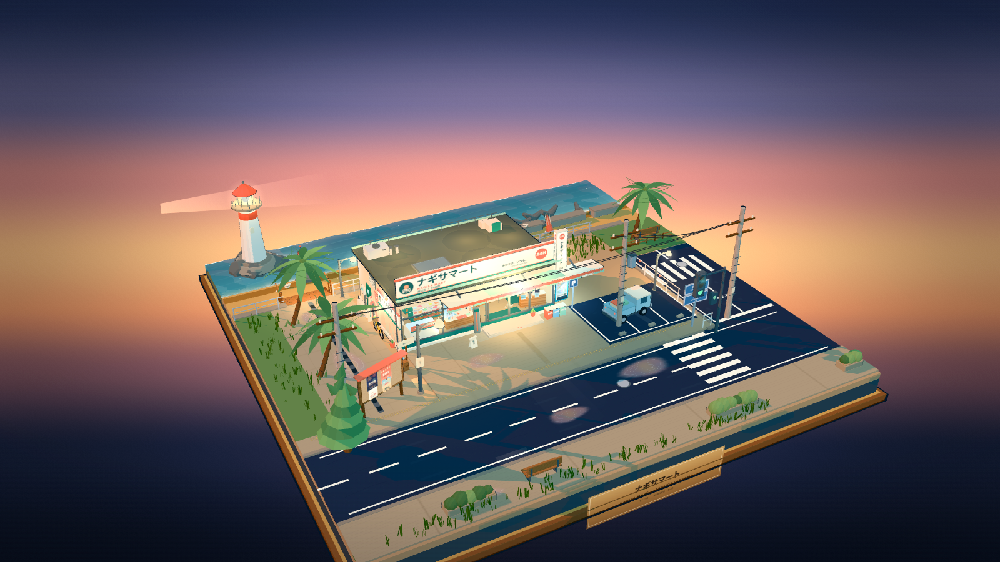
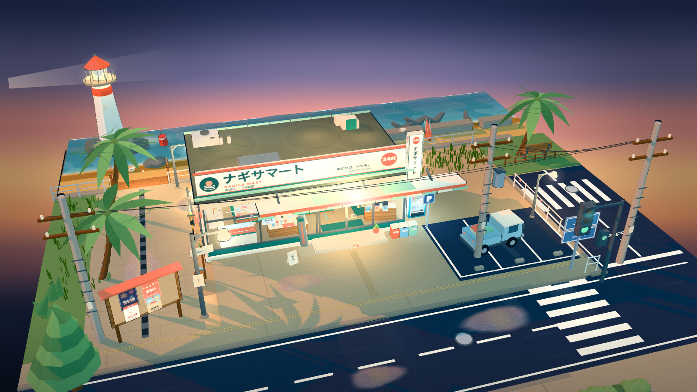
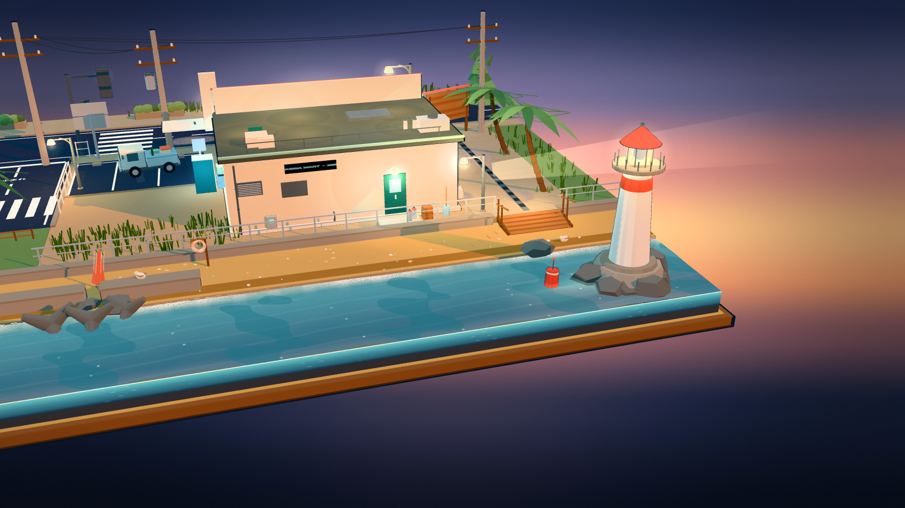

# 海边便利店 · ナギサマート

> 盛夏黄昏，一间亮着灯的日式便利店，落在 36 × 36 的正方形树脂微缩底座上。
> 第三人称自由环绕，可拖拽旋转、滚轮 / 双指缩放；画面内没有任何 UI。



| 店前细节 | 海側与灯塔 |
| --- | --- |
|  |  |

- 来源提示词：[`PROMPT.md`](PROMPT.md)（转录自 [`docs/prompts/海边便利店提示词.md`](../../docs/prompts/海边便利店提示词.md)）
- 性质：`lab/` 实验项目，纯前端、无构建步骤、无外部模型 / 贴图 / CDN。
- 技术栈：Three.js r187（本地 vendor）+ 程序化几何 + Canvas 招牌与海报 + 自定义 GLSL 水面 / 切面 / 涟漪。

## 运行

```bash
cd lab/seaside-store
./run.sh            # 默认 127.0.0.1:8035
# 或指定端口
./run.sh 8080
```

然后打开 `http://127.0.0.1:8035/`。

ES module 不能稳定通过 `file://` 加载，所以需要静态服务器。

### 视角参数

| 参数 | 说明 |
| --- | --- |
| `?view=hero` | 默认主视角（西南侧俯视，整座底座入画） |
| `?view=front` | 正面全景（店招、雨棚、路口） |
| `?view=detail` | 店前近景 |
| `?view=aerial` | 高位俯瞰（底座布局 / 海陆关系） |
| `?view=alley` | 西侧小巷，可见侧墙招牌、自行车、冲浪板、后门 |
| `?view=corner` | 街角近景（停车位、小货车、信号灯） |
| `?view=sea` | 从海侧回看：沙滩、木阶梯、防波堤、灯塔与树脂切面 |
| `?view=store` | 另一种店前近景 |
| `?t=9.5` | 手动指定动画时间（秒），便于稳定截图 |
| `?noshadow=1` | 关闭阴影，仅用于排查渲染问题 |

### 操作

| 输入 | 行为 |
| --- | --- |
| 鼠标拖拽 / 单指拖动 | 环绕旋转 |
| 滚轮 / 双指捏合 | 缩放 |
| 双击 | 回到默认主视角 |
| `←` `→` `↑` `↓` | 键盘旋转 |
| `+` / `-` | 键盘缩放 |
| `Home` / `0` | 复位 |

## 场景对照

| 提示词里的要求 | 场景中的实现 |
| --- | --- |
| 完整正方形底座，展示级树脂微缩景观 | 36 × 36 木纹展示台 + 黄铜铭牌；地形分土层，海水在底座北缘收成半透明树脂切面 |
| 便利店在视觉中心，正面朝向街角路口 | 11.8 × 7.8 × 4.2 m 店铺；正面玻璃朝南，东南侧是 L 形道路转角 |
| 一侧道路转角，另一侧小巷通向沙滩 | 主路 + 侧路 + 斑马线 + 停车格 + 人行道；西侧 5.8 m 宽小巷直通沙滩木阶梯 |
| 原创日式便利店招牌、风格化假名，无真实商标 | 「ナギサマート / NAGISA MART / 海辺店 / 24H」，全部由 Canvas 绘制 |
| 大面积落地玻璃、自动门、店内一览无余 | 前立面玻璃幕墙；双扇自动门周期性滑开，带出暖光与地面光斑 |
| 店内：货架、饮料柜、便当、饭团、零食、收银台、冰咖啡机、杂志架、海报、灯箱、冰柜、冰淇淋柜、冷饮吧台、导视、储物柜、后场门 | 全部以程序化几何搭建；商品用 InstancedMesh 批量绘制，冷柜有冷雾与冷光，收银台有小风扇与菜单牌 |
| 夏季限定陈列：烟花、蚊香、防晒霜、沙滩玩具、游泳圈 | 前窗双层陈列台 + 泳圈、沙滩球、沙桶、防晒瓶、烟花筒、蚊香盒 |
| 门口：雨棚、地垫、贩卖机、带藤篮自行车、冲浪板架、沙滩伞、分类垃圾桶、路灯、电线杆、交错电线、路牌、街角护栏、停车位、排水沟、浅水洼、反光斑马线、小巷入口、空调外机、夏日祭 / 花火大会公告栏 | 逐项搭建；另有盲道、井盖、车止石、停車場 P 牌、交通信号灯、海へ木牌 |
| 停车位里的浅蓝色小货车 | 浅蓝色轻卡，停在店东侧车格内 |
| 门口斜靠冲浪板、地垫边沙滩拖鞋 | 店门左侧带水光的冲浪板；地垫边一双珊瑚色拖鞋 |
| 不要人物，但保留生活痕迹 | 无人物 / 人影；保留自行车、拖鞋、脚印、木箱、气瓶、晾着的拖把等 |
| 沙滩：防波堤、消波块、救生圈、贝壳、海玻璃、木阶梯、收起的沙滩伞 | 沙滩 + 湿沙带 + 白沫线；木阶梯、矮防波堤、消波块、救生圈、贝壳、海玻璃、折叠伞、海鸥 |
| 海浪 / 泡沫 / 海风 / 空调滴水 / 自动门 / 招牌闪烁 / 冷柜白雾 / 小风扇 / 倒影 / 信号灯 / 灯塔光束 | 全部有克制的循环动画，见下节 |
| 天空由蜜桃橘、珊瑚粉到海盐蓝、靛青 | 屏幕空间黄昏天幕 + 3D 海面；暖光集中在店铺后方，四周收进靛青 |
| 暖色店内 vs 冷色室外 | 店内有暖白灯管与暖黄点光；室外用冷蓝补光、低角度落日和蓝调阴影 |
| 湿路面、浅水洼、斑马线反光 | 自定义水洼着色器、路面湿反光条、浅水洼涟漪 |
| 不要写实、真实品牌、乱码、UI、水印、过曝、脏乱 | 三渲二材质 + 四阶色阶 + 反向外壳描边；无真实品牌、无乱码、无 UI overlay |

## 动效

- 海浪缓慢冲刷沙滩，白色泡沫生成又退去；海面有细碎高光与零散白浪。
- 海风轻摆棕榈叶、风铃、公告栏海报边角。
- 空调外机滴下冷凝水，落入水洼并荡开涟漪。
- 自动门每约 11 秒开合一次，带出一小片温暖的室内光。
- 招牌与灯箱轻微闪烁；冷柜白雾缓缓下沉；收银台小风扇慢慢旋转。
- 湿沙、积水和斑马线倒影随晚霞轻轻晃动；远处信号灯在红 / 黄 / 绿之间缓慢变化。
- 灯塔光束缓慢扫过海面，浮标随浪起伏；归鸟在天空慢慢掠过。

## 技术结构

```text
lab/seaside-store/
├── index.html          全屏画布、import map、无 UI、无 JS 时的说明
├── PROMPT.md           源提示词转录（原文以 docs/prompts/ 为准）
├── run.sh              本地静态服务器
├── src/
│   ├── main.js         渲染器、环绕相机、灯光、屏幕空间天幕、动画循环
│   ├── kit.js          三渲二材质、描边、几何辅助、Canvas 贴图工厂
│   ├── textures.js     全部招牌 / 海报 / 包装 / 地面纹理（Canvas 现画）
│   ├── world.js        底座、道路、停车、沙滩、浅海、灯塔、街道设施、植物
│   ├── store.js        便利店外观、招牌、店内陈设、自动门、后墙 / 侧墙
│   ├── water.js        海面 shader、岸边泡沫、水洼、涟漪、树脂切面
│   └── sky.js          远处薄云与归鸟（天幕在 main.js 里）
├── vendor/             Three.js r187 + LICENSE（本地 vendor，无 CDN）
└── shots/              1600 × 900 截图（hero / front / detail / aerial / alley / sea）
```

- 没有构建步骤；改完源文件刷新即可。
- 所有模型和贴图都在浏览器里程序化生成，不依赖外部资产。
- 材质以 `MeshToonMaterial` + 四阶 `gradientMap` 为主；重要形体加反向外壳描边。
- 招牌 / 海报 / 杂志封面 / 贩卖机 / 路牌 / 地砖 / 沥青 / 沙地均为 CanvasTexture。

## 验证

- 全部 `src/*.js` 通过 `node --input-type=module --check` 语法检查。
- Headless Chrome（1600 × 900）打开 8 个视角，控制台无 JS 异常；仅缺省 favicon 的 404，已在 `index.html` 中用内联 SVG 图标消除。
- 用 Chrome DevTools Protocol 模拟拖拽与滚轮：相机位移分别为 38.2 / 15.3（场景单位），环绕与缩放均生效。
- 截图参数：`?view=…&t=9.5`，1600 × 900；`shots/` 下为最终产物。
- 无人物、无真实品牌、无乱码文字、无 UI 按钮 / 操作面板；`src/` 中无 `seven` / `familymart` / `lawson` 等品牌词。

## 边界与说明

- 这是**风格化微缩场景**，不是照片级写实；没有做后处理 bloom、SSAO 或体积雾，光泽与雾气主要由程序化 sprite 与材质表现。
- 天幕是屏幕空间的固定黄昏背景，因此相机环绕时背景不会真实移动；海面、云和归鸟仍是三维的。
- 未做音频；页面内没有任何可见 UI，符合提示词“画面中没有任何 UI 界面元素”。
- `lab/` 默认豁免工作区根规则。若把本页嵌入需要 R-016 的文档 / HUB，请在宿主层补 `system / light / dark` 三态主题控件；场景本身固定为黄昏光照，不随主题变浅。
- 移动端可运行，但大量程序化几何在低端设备上可能降低帧率。

## 变更日志

见 [`CHANGELOG.md`](CHANGELOG.md)。
