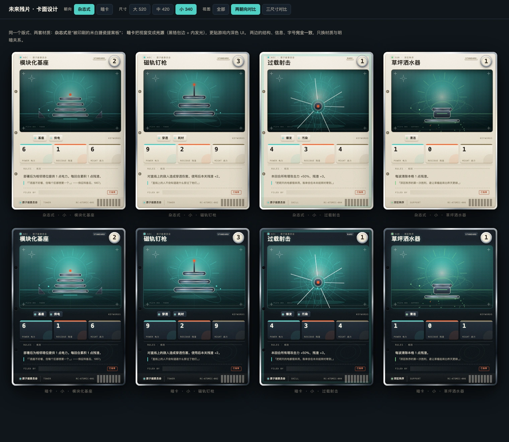
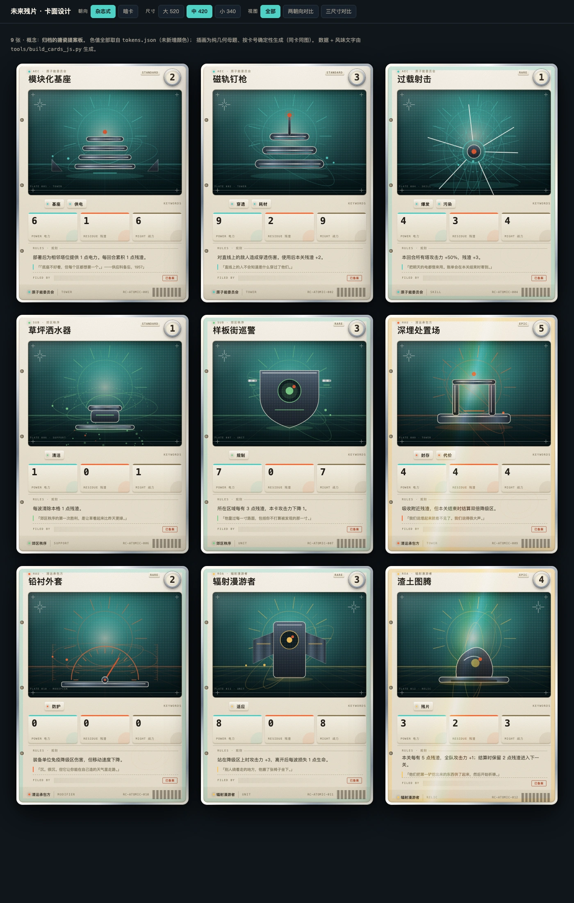
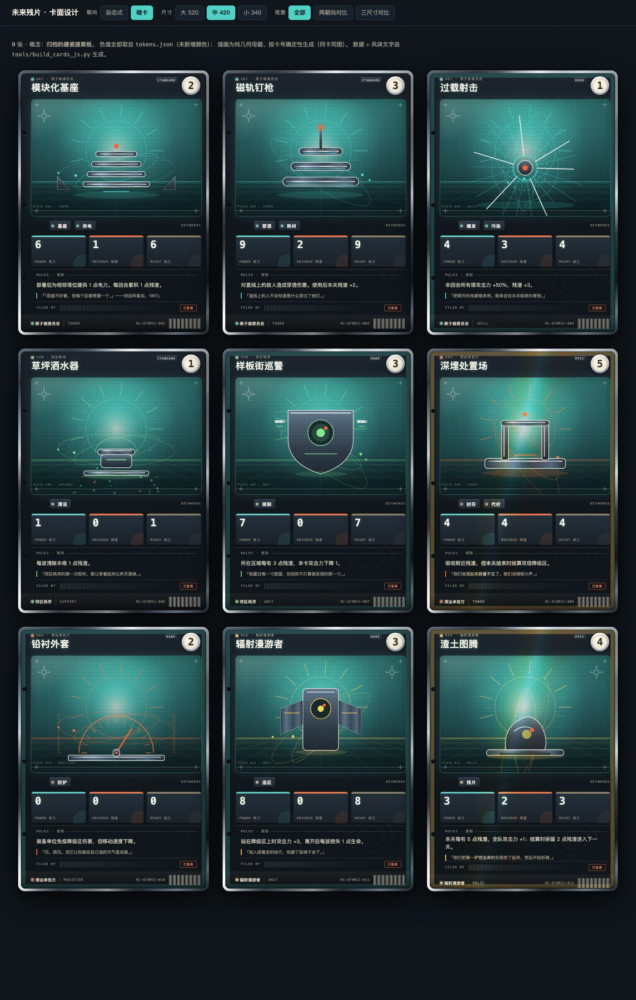
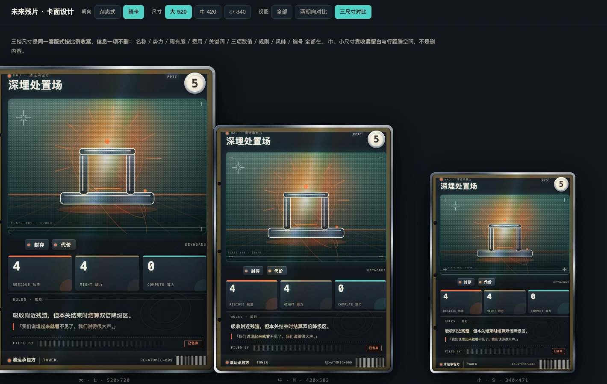

# cards · 卡面设计（进化试验台）

> **这是什么**：卡面**设计**的实验区——在这里把卡面做好看，定稿后再回灌到游戏的
> [`CardView`](../future-debris/game/scripts/view/card/card_view.gd)。
> **这不是**游戏内实现：这里不跑 Godot，只产出版式与材质规范。
>
> 打开 [`index.html`](index.html) 看九张样卡（双击即可，数据在同目录 `cards.js`）。



| 杂志式（light） | 暗卡（dark） |
| --- | --- |
|  |  |

三档尺寸（同一套版式，信息不删）：

## 一、为什么要有这个目录

游戏里的卡面（`card_view.gd`）六段布局是**对的**：`TOP 64 / ART 300 / KEYS 44 / STATS 90 / TEXT 120 / BOTTOM 48`。
问题是**材质语言没做出来**——[`docs/02 风格卡`](../future-debris/docs/style-samples/02_风格卡_原子纪元.svg) 早就规定了
镀铬 / 搪瓷 / 半透明塑料、星爆 / 电子轨道 / 放射线、扫描线 / 网点，但实现出来是一片片**纯深色矩形**：
没有反射、没有网点、没有颗粒。**规则写到了，手没做到。**

所以进化不是换风格，而是**把那套语言真正渲染出来**，并补上那个时代真实的工业物件细节。

## 二、设计概念：归档的搪瓷提案板

主线项目的立意是"**向一个相信清洁能源的明天提交提案，代价是残渣**"。
于是卡片不是"UI 面板"，而是**一件归档的实物**：

| 层 | 做法 | 为什么 |
| --- | --- | --- |
| **搪瓷面** | 米白 `--cream` 平涂 + 顶部高光 + 底部压边 | 那个年代的厨房电器、仪表盘、路牌都是搪瓷 |
| **镀铬包边** | 多段渐变模拟长反射（暖白→冷蓝灰→暖白）+ 一条斜向镜面高光带 | 风格卡 CHROME 的定义；这是"贵"的来源 |
| **凹陷视窗** | 内阴影 + 玻璃罩高光 | 插画是"嵌在面板里的窗"，不是贴图 |
| **印刷工艺** | 网点 halftone + 扫描线 + 颗粒 | 它是**被印出来的东西**，不是发光的屏幕 |
| **归档痕迹** | 打孔、套准标记、压印序号（`PLATE 001 · TOWER`）、条码、`已备案`章 | 它**被提交、被登记、被归档**——与"提案"这个词对齐 |

## 三、两套朝向（都已出，待你选）

`?theme=light|dark` 切换。**结构、信息、字号完全一致**，只换材质与明暗关系：

| | 杂志式 `light` | 暗卡 `dark` |
| --- | --- | --- |
| 概念 | 被**印刷**出来的米白搪瓷提案板 | **黑铬**包边，视窗成为**光源** |
| 面 | 米白搪瓷 + 镀铬包边 | 近黑搪瓷 + 黑铬包边（石墨→银的反射） |
| 视窗 | **凹陷**（内阴影），插画嵌在里面 | **发光**（内发光 + 外光晕），插画就是亮度来源 |
| 文字 | 深墨压米白 | 米白压深底，标题带极弱辉光 |
| 颗粒 | `multiply`（压暗） | `screen`（提亮），强度更低 |
| 稀有度 | 箔带压在米白上（偏"印刷亮油"） | 箔带压在深底上（偏"镭射膜"，更明显） |
| 适合 | 收藏感、实物感、商店页大图 | **更贴游戏内深色 UI**，战斗界面里不刺眼 |

> 我的判断：**商店页用杂志式、局内用暗卡**。两者共用同一套版式与数据，切换只是换一层材质——
> 这不是"两版设计"，是**一套设计的两种明暗关系**。当然也可以只留一种。

## 四、三档尺寸（信息一项不删）

| 尺寸 | 规格 | 用途（设想） | 关键调整 |
| --- | --- | --- | --- |
| **L** | 520×720 | 卡牌库详情、商店页 | 完整留白与字号 |
| **M** | 420×582 | 手牌放大、构筑界面 | 留白收紧，字号 ×0.81 |
| **S** | 340×471 | **局内手牌**、手机竖屏 | 字号 ×0.65，视窗占比降到 39%，把空间让给文字 |

小尺寸不是"把大图缩小"——那样字会小到看不清。做法是**按档位重设一套令牌**
（`--h-art` / `--f-rules` / `--f-num` … 全部走 CSS 变量），**名称/势力/稀有度/费用/关键词/三项数值/规则/风味/编号 一项不删**。

## 五、风味文字

风味与规则**分开维护**：规则说机制，风味说这个世界怎么想。

- 存在 [`flavor.json`](flavor.json)（作者文案，便于单独校对与替换），由 `build_cards_js.py` 并进 `cards.js`。
- **没有并入游戏卡表**：那需要改 `cards.json` 的 schema 与校验，等定稿后再做。
- 例：「**我们说埋起来就看不见了。我们说得很大声。**」（深埋处置场）

## 六、视觉系统

**色值全部取自 [`game/data/tokens.json`](../future-debris/game/data/tokens.json)，未新增任何颜色。**

| 用途 | 取值 | 说明 |
| --- | --- | --- |
| 卡面 | `#F3EDE1 / #E7DFCD / #D8CEB8` | 锆白系列（搪瓷） |
| 镀铬 | `#FFFDF6 / #C9CDD2 / #6F7B89 / #8E9AA6` | 暖白→冷蓝灰，长反射 |
| 视窗底 | `#123236 → #041012` | 深搪瓷/墨绿 |
| 墨色 | `#241f17 / #4a3f2c / #8a7f66` | 米白底上的文字层级 |
| 残渣 | `#FF6B35` | 数值条 + 关键词点 |
| 算力 | `#4FD1C5` | 数值条 |
| 战力 | `#8C7A55` | 中性金褐（刻意不用强调色，避免与资源抢注意力） |

**势力色＝从既有资源色里指派**（不新增色）：AEC `#4FD1C5` ／ SUB `#7BD389` ／ HAU `#FF6B35` ／ ROA `#FFC857`。
这与四势力的"残渣姿态"（清理/回避/搬运/喂养）在语义上也对得上——清理者是青的、喂养者是琥珀的。

**字体**：卡名用系统无衬线粗体；所有数字与标签用等宽（`Menlo`），与 tokens 的 `number-lg` 约定一致。
等宽在这里不只是风格，它让"数值"和"说明文字"在同一张卡上**可区分**。

**稀有度**（三档，目前卡表只有 common/rare/epic）：
`common` 无额外处理 · `rare` 青绿内描边 · `epic` 金色内描边 + **斜向箔带**。

## 七、插画：程序化几何，不需要美术逐张画

风格卡规定「**只用圆角矩形 + 长反射条 + 单点镜红**」，所以这里不画写实图像。
六种母题（对应卡的 `kind`），每种 **3 个构图变体**，由**卡号确定性选取**（同一张卡永远同一幅图）：

| kind | 母题 | 变体 |
| --- | --- | --- |
| `tower` | 堆叠基座 + 中央天线 | 三级堆叠／宽基座双塔／四层细叠+侧翼 |
| `unit` | 徽章体 | 拱形盾／六边碑+光冠／立板+双翼 |
| `skill` | 放射爆发 + 冲击环 | — |
| `support` | 喷洒器 + 水弧 + 落点 | 单头宽／单头窄／双头 |
| `modifier` | 校准表盘 + 双刻度尺 | 指针角度×3 |
| `relic` | 标本台 + 悬浮体 | — |

共用的构图公式（保证"同一个世界"）：
`天空辉光 → 大日盘+放射线 → 地平线与透视地面 → 深漆器主体（亮铬轮廓）→ 电子轨道 → 前景细栏 → 星爆`。

**主体的明暗层级是这次的转折点**：一开始把主体做成整块亮金属，结果是**一坨发白的 blob**（渐变把轮廓吃掉了）。
改成 **深漆器 + 亮铬轮廓 + 强调色细线** 之后才有了形体——大面积不反光，只有边缘反光，这是真实的搪瓷/漆器逻辑。

## 八、怎么用

```bash
# 看：双击 index.html（顶部可切 朝向 / 尺寸 / 视图）
open index.html

# 出全套：2 朝向 × 3 尺寸 × 9 张 = 54 个 WebP 到 out/（导出物，gitignore）
#         + 4 张对比预览 preview-*.webp（入库）
./render.sh

# 只重出预览（快）
./render.sh --preview

# 卡表或风味改动后，重建数据
python3 tools/build_cards_js.py
```

- **格式**：Chrome 出 PNG → `cwebp -q 95`（高质量，不为体积牺牲观感）。
- **单张模式**：`?card=<卡号>&theme=dark&size=s` —— 会把工具栏与留白去掉、把卡片钉到左上角，
  导出图**恰好等于卡面**（这个坑踩过：不去外壳会截到工具栏、卡片被裁）。

`index.html` 支持 `?card=<卡号>`（单张）与 `?sheet=1`（联系表），`render.sh` 就是用这两个出的图。

## 九、和工程的关系

- **数据来源**：`cards.js` 由 [`tools/build_cards_js.py`](tools/build_cards_js.py) 从
  `future-debris/game/data/tables/cards.json` **现读生成**，不手抄——手抄必然与卡表分叉。
- **版式契约**：六段高度沿用 `card_view.gd` 的既有分配（`TOP 70 / ART 316 / KEYS 40 / STATS 84 / TEXT 弹性 / BOTTOM 46`，
  视窗比原来高 16px，把规则区的空白吃掉）。
- **回灌路径**：定稿后把「材质分层 + 字号/间距 + 稀有度处理」写成 `card_view.gd` 的绘制顺序与
  tokens 的扩展（需要新增的只有"镀铬渐变停止点"与"墨色层级"两组，仍不需要二进制资源）。

## 十、还没定的（等你判断）

1. **卡面朝向**：两版都已出（见 §三）。**要选一版，还是按场景混用**
   （商店页/收藏用杂志式，局内用暗卡）？——这是现在最该定的一件事，它决定后面打磨的方向。
2. **插画做到什么程度**：现在是纯几何母题（不需要美术）。若未来有美术产能，
   可以只替换"视窗内"这一层而不动版式——这是刻意留的接口。
3. **风味文字的范围**：目前只给 9 张展示卡写了（见 `flavor.json`）。
   要给 120 张都配吗？——这是**创作量**问题，不是技术问题；也可只给稀有卡配，让稀有卡更贵。
4. **稀有度要不要第 4 档**（legendary）：卡表目前最高是 epic，加档会影响掉落与平衡。
